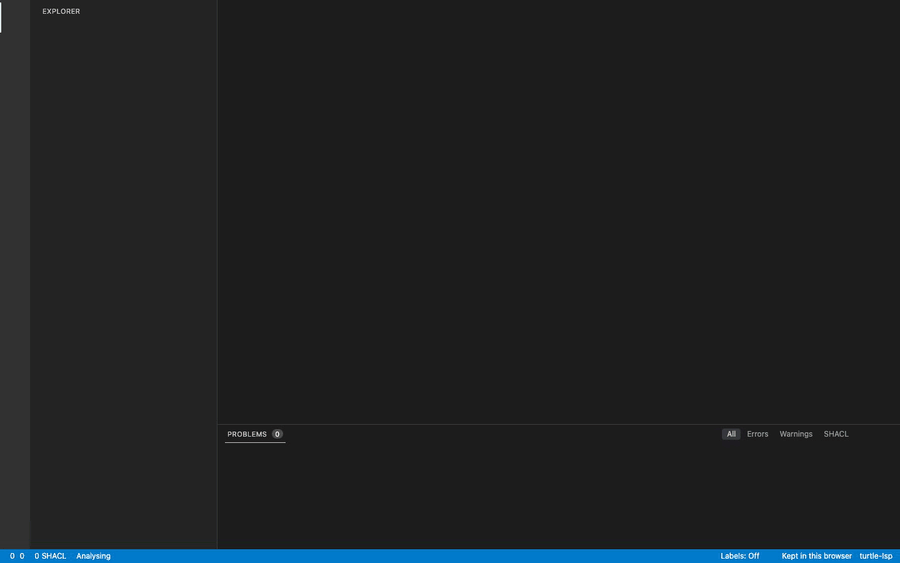

<p align="center"></p>

<p align="center"><a href="https://github.com/abhishekkundu25/turtle-lsp/actions/workflows/ci.yml"></a> <a href="LICENSE"></a> <a href="#tested-against-the-real-world"></a> <a href="#tested-against-the-real-world"></a> <a href="#tested-against-the-real-world"></a> <a href="#tested-against-the-real-world"></a></p>

# turtle-lsp

A fast language server for RDF Turtle (`.ttl`), written in Rust. It also
reads TriG, N-Triples, N-Quads and JSON-LD, and SPARQL queries and updates.

A keystroke in a 30,000-line file gets fresh diagnostics in about 5 ms, and
the whole file formats in about 5 ms. The server starts in a few milliseconds.

**[Try it in your browser](https://abhishekkundu25.github.io/turtle-lsp/)**: the same server, compiled to
WebAssembly, in an editor that runs entirely in the tab. Nothing is uploaded.

<p align="center"></p>

It is the only Turtle language server we know of that checks itself against
the full W3C test suites and real public ontologies; see
[Tested against the real world](#tested-against-the-real-world).

## Features

- **Diagnostics**: syntax errors with recovery (one mistake does not hide the rest of the file), undeclared/unused/duplicate prefixes, unknown or deprecated terms of well-known vocabularies (matched by namespace IRI, with "did you mean"), invalid IRIs and language tags.
- **Completion**: after `prefix:`, terms of that namespace from 80+ bundled vocabularies and from your workspace, ranked by position (classes after `a`, properties in predicate position). Properties a SHACL shape requires for the subject's class come first ("required by …"), then properties whose `rdfs:domain` fits; after a property, instances of its range (or `sh:class`) come first and `sh:in` values are offered. Typing a bare local name (`Pers`) finds `foaf:Person`. Completing a well-known prefix that is not declared adds its `@prefix` line.
- **Hover**: label, comment, types and where a term is described.
- **Navigation**: go to definition (where a resource is the subject), type definition (the resource's class), implementation (a class's instances and subclasses), references, rename across files, document highlight. On the prefix part of `ex:a`, these work on the prefix.
- **Semantic highlighting and label hints**: IRIs are coloured by what they denote (class, property, individual, datatype), and an opaque name such as `ex:P0042` can show its label after it.
- **Outline and search**: document symbols, workspace symbols, folding.
- **Formatting**: one consistent layout for Turtle, TriG, N-Triples and N-Quads, built from the tokens: comments and statement order are kept, the graph never changes, and formatting twice changes nothing. Files with syntax errors are left alone.
- **Quick fixes and refactorings**: add a missing prefix (your project's own binding first), add all missing prefixes, remove an unused prefix, fix a misspelled term; organise prefixes, shorten or expand an IRI, and extract a prefix for a repeated namespace.
- **Type hierarchy**: super- and subclasses (and sub-properties) across the workspace, imports and vocabularies.
- **Lints**: terms used in one of your own namespaces but described nowhere (with "did you mean"), and SHACL shapes as you type: a property shape without `sh:path`, an unknown `sh:class`, a non-datatype `sh:datatype`, parameters a node shape cannot have, dangling shape references, `sh:minCount` above `sh:maxCount`.
- **Imports**: `owl:imports` of an ontology in the workspace just work; others resolve through a Protégé `catalog-v001.xml` or the import cache, or (with `turtle.imports.network` on) are fetched once and cached. Imported terms (Turtle, N-Triples or RDF/XML, followed up to 5 levels deep) feed hover, completion and lints. An import that can't be resolved gets an information diagnostic saying how to resolve it, with a quick fix that fetches that one web import and caches it, even with the setting off. Go to definition on an imported term opens the cached copy, which is read-only: it gets no diagnostics.
- **Turtle 1.2**: triple terms `<<( )>>`, reified triples `<< >>`, `~` reifiers, `{| |}` annotations, `@lang--dir`, `VERSION`.
- **TriG, N-Triples and N-Quads**: `.trig`, `.nt` and `.nq` files get the same features. See [TriG, N-Triples and N-Quads](#trig-n-triples-and-n-quads).
- **SPARQL**: `.rq`, `.sparql` and `.ru` files (queries and updates, SPARQL 1.1 and 1.2) get the same knowledge of the workspace and the vocabularies: diagnostics, completion, hover, navigation, rename, formatting and quick fixes. See [SPARQL](#sparql).
- **JSON-LD**: `.jsonld` files (JSON-LD 1.1) join the workspace: their terms count in Turtle and SPARQL files, SHACL shapes validate their data with results on the key or value, and they get JSON syntax, context, undefined-key, IRI and language-tag diagnostics, plus completion, navigation, rename, formatting and semantic tokens inside the file. See [JSON-LD](#json-ld).
- **Conformance**: W3C Turtle, TriG, N-Triples and N-Quads test suites, RDF 1.1 and 1.2: 1137/1137 pass (`tests/w3c_conformance.rs`); W3C SPARQL 1.1 and 1.2 syntax suites: 425/426 (`tests/w3c_sparql.rs`); W3C JSON-LD 1.1 toRdf, expand and remote-doc suites: every test in scope but two (`tests/w3c_jsonld.rs`, see [JSON-LD](#json-ld)).
- **SHACL validation**: on save, and about a second after you stop typing, the workspace is validated against its SHACL shapes in the background (Turtle files together; each TriG or N-Triples dataset with them, never merged with another dataset) (SHACL Core and SHACL-SPARQL; W3C suites 98/98 and 23/23, `tests/w3c_shacl.rs`). Results appear on the offending triple, with the shape as related information. Settings `turtle.shacl.enabled`, `turtle.shacl.maxTriples` and `turtle.shacl.onType` (validate while typing; on by default).

## Tested against the real world

Every release is checked against the official W3C test suites and against
public RDF files anyone can download (`npm run corpus`, results in
[docs/research/corpus-validation.md](docs/research/corpus-validation.md)).

| Check | Result |
|---|---|
| W3C Turtle, TriG, N-Triples and N-Quads suites | 1137 / 1137 |
| W3C SPARQL 1.1 and 1.2 syntax suites (query, update, federation) | 425 / 426 ¹ |
| W3C SHACL Core suite | 98 / 98 |
| W3C SHACL-SPARQL suite | 23 / 23 |
| W3C JSON-LD 1.1 suites: toRdf, expand, remote-doc | 443, 365 and 6 pass; 2 known failures; the rest out of scope ³ |
| JSON-LD on 364 public documents (schema.org examples, ActivityStreams, Verifiable Credentials 1.0 and 2.0, IIIF, DCAT-US, Croissant, GS1, DID) vs. [oxjsonld](https://crates.io/crates/oxjsonld) | Same graph for 339; the other 25 are known differences where oxjsonld departs from JSON-LD 1.1 ⁴ |
| Parser vs. [Oxigraph](https://github.com/oxigraph/oxigraph) on public files (schema.org, Wikidata, DBpedia, QUDT, Brick, Gene Ontology, W3C vocabularies, a Web Data Commons N-Quads dump) | Same quads in 98 of 99 cases (2.56 million triples) ² |
| Formatter on the same files | Never changed a graph, never dropped a comment; formatting twice changes nothing |
| SPARQL on 1,317 real queries ([SIB sparql-examples](https://github.com/sib-swiss/sparql-examples): UniProt, Rhea, Bgee, neXtProt, ...) | Same verdict as [spargebra](https://crates.io/crates/spargebra) on all; the formatter kept every query's algebra and comments, and formatting twice changes nothing |
| Gene Ontology (118 MB, 1.28 million triples) | Parsed in 0.4 s, formatted in 0.8 s |
| Fuzz testing | 20,000 randomly damaged files, every editor feature run on each, without a crash |
| Resource checks | No CPU use while idle, no server left running after the editor quits |

¹ The one left is a SPARQL 1.2 proposal (a projected variable reused in a
later `SELECT` expression) that the SPARQL parser library rejects.
² The other is the Web Data Commons slice: 26 of its 57,000 lines have a `[`
inside an IRI, which Oxigraph rejects and turtle-lsp accepts.
³ See [Conformance](#conformance) under JSON-LD.
⁴ Listed with the reasons in `tests/jsonld_oracle.rs`; see
[Conformance](#conformance) under JSON-LD.

## Performance

Benchmark: one 30,005-line file (5,000 resources) open in a workspace of 200
other Turtle files (40,000 more resources). The client is a script that talks
to the server over stdio, the way an editor does. Times are end to end,
including JSON encoding and the pipe.

| | Previous Node.js server | turtle-lsp (Rust) | Speedup |
|---|---:|---:|---:|
| Keystroke → diagnostics, median | 4,911 ms | **4.3 ms** | ~1,100× |
| Keystroke → diagnostics, p95 | 8,341 ms | **9.6 ms** ¹ | ~870× |
| Start-up (`initialize`) | 2,537 ms | **4 ms** | ~600× |
| Open file → first diagnostics | 1,884 ms | **30 ms** | ~60× |
| Completion after `foaf:` | 21 ms | **0.2 ms** | ~100× |
| Completion with nothing typed | 476 ms, 48,203 items, 9.5 MB | **0.1 ms**, 6 items, 1 KB | |
| Go to definition | 0.1 ms, 7 locations (every use) | **0.1 ms**, 1 location (the definition) | |
| Format the whole file | — | **5 ms** | |
| Semantic tokens, whole file | — | **6 ms** | |
| Save → SHACL results (~180k triples) | — | **13 ms** | |
| Memory (resident, after indexing) | 959 MB | **138 MB** | ~7× less |

¹ Only the first edit after opening the file is that slow (it takes over from
the indexed copy); later keystrokes take 4.3–4.9 ms.

JSON-LD against Turtle of the same length (about 30,000 lines each; the
JSON-LD file has 1,499 people under an inline `@context`), each opened alone
in an empty workspace:

| | Turtle | JSON-LD |
|---|---:|---:|
| Open file → first diagnostics, median | 5.1 ms | **6.4 ms** (1.3×) |
| Keystroke → diagnostics, median | 4.1 ms | **5.9 ms** |
| Hover | 0.1 ms | **0.1 ms** |

`tests/jsonld_budget.rs` holds release builds to the JSON-LD budgets: opening
within 3× the Turtle time, and a keystroke under 10 ms.

Measured on an Apple M6 with macOS 27. Results vary a little between runs.
Reproduce with `npm run bench`.

Why it is fast:

- **One parse per edit.** Each document version is parsed once, by a
  hand-written lexer and parser, and every feature reads that result. The
  previous server parsed each document about seven times per keystroke.
- **Batched edits.** The server reads every queued message before it computes
  diagnostics, so a burst of keystrokes costs one analysis.
- **Small replies.** Completion returns at most 200 ranked items and loads
  their documentation only when you select one.
- **Background indexing.** Workspace files are parsed in parallel on a
  separate thread, so start-up does not wait for them.
- **Embedded vocabularies.** 84 vocabularies (about 21,000 terms) are compiled
  into the binary and parsed only when first used.

## Project prefixes

Turtle files often leave out their `@prefix` lines and rely on a shared header.
Put the header in a `prefixes.ttl` file: every Turtle file in that directory or
below it can use those prefixes. You can also set prefixes in
[`turtle-lsp.json`](#settings-file-turtle-lspjson) or pass them from the editor:

```lua
init_options = { prefixes = { ex = "http://example.org/" } }
```

## TriG, N-Triples and N-Quads

The server also reads TriG (`.trig`), N-Triples (`.nt`) and N-Quads (`.nq`)
files. It takes the language from the editor's language id (`turtle`, `trig`,
`ntriples`, `n-triples`, `nquads` or `n-quads`). If the editor sends another
id, the file extension decides.

- **TriG**: graph blocks `{ ... }`, `ex:g { ... }` and `GRAPH ex:g { ... }`.
  Triples outside a block are in the default graph. Go to definition on a
  graph name finds its blocks and the statements about it. The outline shows
  each block with its subjects, and blocks fold. A `prefixes.ttl` applies to
  TriG files as it does to Turtle files.
- **N-Triples**: one triple per line with full IRIs. The server reports
  everything N-Triples does not allow as an error: directives, prefixed names,
  `a`, `;` and `,`, `[ ]`, collections, unquoted numbers and booleans, single
  quotes and long strings, relative IRIs, reified triples and annotations.
  RDF 1.2 triple terms `<<( s p o )>>` are allowed. N-Triples files get no
  prefixes from `prefixes.ttl` or the editor settings.
- **N-Quads**: N-Triples plus an optional graph label (an IRI or a blank node)
  before the final `.`. Everything said about N-Triples above applies. A graph
  label that is not an IRI or blank node, or a fifth term, is an error. The
  outline groups statements by graph, and formatting writes one quad per line.
  The quads join the workspace like a TriG file's, so terms described in a
  `.nq` file count as described.

The workspace index covers `.ttl`, `.turtle`, `.trig`, `.nt`, `.nq` and
`.jsonld` files.

## SPARQL

SPARQL files (`.rq`, `.sparql`, `.ru`; language id `sparql`) get the
language-server features of Turtle files, built on the same knowledge of the
workspace and the vocabularies. Queries and updates, SPARQL 1.1 and 1.2, are
accepted in any of these files: the server checks a document as what it holds,
not by its extension.

- **Diagnostics** as you type: syntax errors at the token where the query
  stops making sense, undeclared, unused and duplicate prefixes, unknown or
  deprecated vocabulary terms with "did you mean", terms in your own
  namespaces that nothing describes (`turtle.lint.undescribedTerms`), and a
  projected variable that the `WHERE` clause never binds.
- **Completion** of keywords by context, variables after `?` or `$`,
  prefixes, terms (classes after `a`, properties in predicate position,
  properties whose `rdfs:domain` fits first) and built-in functions.
  Accepting a term whose prefix is not declared adds its `PREFIX` line.
- **Hover** and **label inlay hints** as in Turtle.
- **Navigation**: go to definition (a term to where the workspace describes
  it, a prefix to its `PREFIX` line, a variable to its first occurrence in
  its scope), references (a term's uses in the workspace too), document
  highlight.
- **Rename** of variables (within their scope, keeping `?` or `$`), prefixes,
  and terms: renaming a term in a Turtle file also renames it in the
  workspace's SPARQL files, and the other way round.
- **Formatting** that indents groups, puts one triple pattern per line,
  aligns the `PREFIX` block and keeps comments. The formatted query must
  parse to the same algebra, or nothing changes. Queries with syntax errors
  are left alone.
- **Quick fixes and refactorings**: add a missing `PREFIX`, add all missing
  prefixes, remove an unused one, fix a misspelled term, organise prefixes,
  shorten or expand an IRI.
- **Semantic highlighting, folding and outline** (the query form, or each
  update operation, with its clauses).

Prefixes from `prefixes.ttl` and `turtle.prefixes` count as declared in
queries too. SPARQL files add nothing to the workspace's knowledge, so a
query never makes a misspelled term look described. The server never runs a
query or contacts an endpoint.

## JSON-LD

JSON-LD 1.1 files (`.jsonld`, language id `jsonld`) are RDF like the other
formats. Plain `.json` files are not read, even with an `@context`.

- **Diagnostics**: JSON syntax errors at the exact position, with recovery
  (`json-syntax`); invalid `@context` definitions, cycles, redefined
  protected terms and contexts that cannot be loaded (`jsonld-context`); a
  key the context does not define, which JSON-LD silently drops
  (`jsonld-undefined-term`, a warning); invalid IRIs and malformed language
  tags at the value (`invalid-iri`, `invalid-language-tag`). The vocabulary
  lints apply to IRIs reached through the context: `unknown-term` with "did
  you mean", `deprecated-term`, and `undescribed-term` for your own
  namespaces.
- **One workspace**: classes and properties a JSON-LD file describes are
  known in Turtle and SPARQL files (completion, hover, references, no
  `undescribed-term`), and the other way round. `owl:imports` of an ontology
  declared in JSON-LD resolve.
- **SHACL**: Turtle shapes validate JSON-LD data, and shapes written in
  JSON-LD are used. Each result is on the key, value or `@id` that breaks
  the shape, or on the opening brace of a node without an `@id`. Named graphs (`@graph` with `@id`) follow the TriG rules.
- **Completion**: in a key, the terms of the context in force at the cursor
  (scoped contexts included), properties the workspace describes under
  `@vocab`, and `prefix:local` names; in an `@type` value, classes the same
  way. It works in half-typed JSON. Completing `prefix:` for a known prefix
  the context lacks also adds it to the `@context` (an idea from
  [SWLS](https://github.com/SemanticWebLanguageServer/swls)).
- **Navigation**: hover on a key shows its expanded IRI, and on an `@type`
  value also what the workspace says about it. Go to definition on a term
  goes to its `@context` entry, in the file or in a context file of the
  workspace; on a term of a bundled or remote context, or a key `@vocab`
  maps, it goes to where the workspace describes the IRI. References and
  highlights on a term list its definition, its uses and the IRI's uses in
  other files.
- **Rename**: renaming a term or a keyword alias changes its `@context` entry
  and every use, and nothing else. Renaming an IRI, from any file, rewrites
  each JSON-LD use in its own form: compact, `@vocab`-relative, relative to
  `@base`, absolute, or the term definition it comes through. A rename that
  cannot be written safely is refused with the reason.
- **Formatting**: the layout of `JSON.stringify` with the editor's indent;
  numbers, escapes and key order are kept, and the result must be the same
  JSON value. A file with JSON syntax errors is not formatted.
- **Semantic tokens and outline**: keywords and aliases, properties and
  classes get their own colours; the outline lists node objects by `@id` and
  nests a named graph's nodes under the graph.
- **Command line**: `turtle-lsp check` checks `.jsonld` files with the same
  codes, positions, exit codes and JSON and SARIF output as Turtle files, and
  `turtle-lsp format` formats them.
- **Browser**: the [browser editor](https://abhishekkundu25.github.io/turtle-lsp/)
  gives JSON-LD files the same diagnostics and SHACL results. It uses the
  bundled contexts and contexts in other files of the workspace, and never
  fetches one.

**Contexts.** A remote `@context` is loaded, in order, from a file in the
workspace (a relative reference), the import cache, then the contexts bundled
with the server: schema.org, ActivityStreams, Verifiable Credentials v1 and
v2, and DID v1 (`data/jsonld-contexts`). The network is off by default, so
opening a file never goes online; a context that cannot be loaded is a
`jsonld-context` error at its URL. Turn the network on with the
`imports.network` setting (`turtle.imports.network` in VS Code) or `--network`
on the command line. A fetched context goes into the import cache and is read
from there afterwards, network or not. Processed contexts are kept in memory,
so re-checking a document processes only its inline contexts.

**Not supported**: compaction, flattening, framing, converting between
JSON-LD and Turtle, `.json` files, and editing bundled or remote contexts.

### Conformance

The W3C JSON-LD 1.1 API suites, run offline by `tests/w3c_jsonld.rs`, with a
status per test in `tests/w3c/jsonld/expected-status.tsv`:

| Suite | Pass | Known failure | Out of scope |
|---|---:|---:|---:|
| toRdf | 443 | 0 | 24 |
| expand | 365 | 2 | 19 |
| remote-doc | 6 | 0 | 12 |

- **Out of scope:** tests for JSON-LD 1.0 only (`specVersion` or
  `processingMode` `json-ld-1.0`; 37 tests), options the engine does not have
  (`expandContext`, 2; `rdfDirection`, 4), and remote-doc tests about loading
  the input document itself (HTTP `Link` headers, HTML, content types,
  missing documents; 12). The compact, flatten, frame, fromRdf and HTML suites are not run.
- **Known failures:** both are in how the test runner reads the expected
  expanded output (a number serde_json rounds differently, and a node with
  `"@id": null`); the same inputs pass in the toRdf suite.

On 364 public JSON-LD documents from schema.org, ActivityStreams, Verifiable
Credentials 1.0 and 2.0, the IIIF cookbook, DCAT-US, Croissant, GS1 and DID
(sources and licences in `tools/corpus/jsonld-sources.tsv`), the graph of
339 is isomorphic to [oxjsonld](https://crates.io/crates/oxjsonld)'s
(`tests/jsonld_oracle.rs`). The other 25 are known differences, each checked
against the JSON-LD 1.1 spec:

- 20 IIIF manifests with template `@id`s (`{{ id.url }}`): JSON-LD drops those
  nodes, and oxjsonld still emits the list triples of their `@list` values;
- 3 Verifiable Credentials where oxjsonld does not wrap an `@id`-coerced value
  of an `@graph` container in a graph object;
- 1 Verifiable Credential where oxjsonld keeps `@direction` as an RDF 1.2
  directional string, which JSON-LD 1.1 toRdf drops;
- 1 DCAT-US dataset where oxjsonld emits a triple from the value of a key no
  context defines.

`tests/jsonld_lints.rs` checks that the same documents get only the JSON-LD
and vocabulary lints listed there, each checked by hand.

## Install

- **VS Code:** install "Turtle RDF & SPARQL Language Server" from the
  [Marketplace](https://marketplace.visualstudio.com/items?itemName=abhishekkundu25.turtle-language-server).
- **Neovim:** see [Neovim](#neovim-011) below (lazy.nvim installs the server for you).
- **Any other editor:** download the server for your machine from the
  [latest release](https://github.com/abhishekkundu25/turtle-lsp/releases/latest)
  (`turtle-lsp-<platform>.tar.gz`, or `.zip` on Windows; checksums in
  `SHA256SUMS`), put `turtle-lsp` on your `PATH`, and point your editor's LSP
  client at it (it speaks LSP over stdio). The same binary is the command-line
  checker and formatter; see [Check from the command line](#check-from-the-command-line).
- **From source:** `cargo build --release` (binary: `target/release/turtle-lsp`).

## Neovim (0.11+)

With [lazy.nvim](https://github.com/folke/lazy.nvim), this repository is the
plugin:

```lua
{
  "abhishekkundu25/turtle-lsp",
  version = "*", -- the latest release; :Lazy update moves to new ones
  config = function()
    vim.lsp.enable("turtle_lsp")
  end,
}
```

That is all. When lazy.nvim installs or updates the plugin it runs
`build.lua`, which downloads the server for your machine from that release
(macOS, Linux and Windows; checked against the release's `SHA256SUMS`) into
the plugin's `bin/`. No Rust needed; on a machine with no download it builds
the server with `cargo` instead. The plugin also brings:

- the server's config, `lsp/turtle_lsp.lua`, for Turtle, TriG, N-Triples,
  N-Quads, JSON-LD and SPARQL buffers, with `prefixes.ttl` or `.git` marking
  the project root;
- the file types Neovim does not detect itself: `.ttl` as `turtle`, `.nq`
  as `nquads` and `.jsonld` as `jsonld`, so plain `.json` buffers stay
  unattached (`.trig`, `.nt`, `.rq` and `.sparql` it already knows; `.ru`
  stays Ruby);
- no modelines in Turtle, TriG and SPARQL files: `@prefix ex: <...>` looks
  like one (" ex:") and would raise E518 on open.

To change a setting, extend the config: for example
`vim.lsp.config("turtle_lsp", { settings = { turtle = { format = { lineWidth = 80 } } } })`
before `vim.lsp.enable`.

Without a plugin manager, put the server on your `PATH` (see
[Install](#install)) and configure it yourself:

```lua
vim.filetype.add({
  extension = { ttl = "turtle", nq = "nquads", jsonld = "jsonld" },
})

vim.lsp.config("turtle_lsp", {
  cmd = { "turtle-lsp" },
  filetypes = { "turtle", "trig", "ntriples", "nquads", "jsonld", "sparql" },
  root_markers = { "prefixes.ttl", ".git" },
})
vim.lsp.enable("turtle_lsp")

-- "@prefix ex: <...>" and "PREFIX ex: <...>" look like a Vim modeline
-- (" ex:"), which raises E518 on open. Turn modelines off for Turtle, TriG
-- and SPARQL files.
vim.api.nvim_create_autocmd("BufReadPre", {
  pattern = { "*.ttl", "*.turtle", "*.trig", "*.rq", "*.sparql" },
  callback = function() vim.opt_local.modeline = false end,
})
```

To build the server from source with lazy.nvim instead of downloading it,
add `build = "cargo build --release"` to the spec and set
`cmd = { vim.fn.stdpath("data") .. "/lazy/turtle-lsp/target/release/turtle-lsp" }`
with `vim.lsp.config("turtle_lsp", ...)`.

## VS Code

The extension in [`editors/vscode`](editors/vscode) bundles the server and adds
syntax highlighting for Turtle, TriG, N-Triples, N-Quads and SPARQL. It also
attaches the server to `.jsonld` files, which keep VS Code's JSON
highlighting. Build and install it:

```sh
cd editors/vscode
npm install
npm run package   # builds the server and writes turtle-lsp-<platform>-<version>.vsix
code --install-extension turtle-lsp-*.vsix
```

Settings: `turtle.server.path` (use another binary), `turtle.prefixes`
(prefixes for every file), `turtle.trace.server` (log LSP traffic), and the
server settings `turtle.inlayHints.labels`, `turtle.shacl.enabled`,
`turtle.shacl.maxTriples`, `turtle.shacl.onType`, `turtle.lint.undescribedTerms`,
`turtle.imports.network` (fetch imports and JSON-LD contexts; off in
untrusted workspaces) and
`turtle.format.lineWidth`.

Other editors pass the server settings without the `turtle.` prefix, as
`init_options` or as the `turtle` section of `settings`:

```lua
init_options = { inlayHints = { labels = "all" }, format = { lineWidth = 80 } }
```

## Settings file (turtle-lsp.json)

An optional `turtle-lsp.json` at the workspace root holds settings for
everyone who works on the project: every editor, the command line, coding
agents and CI. It takes the same keys as `init_options`, nested or dotted
(`"lint.undescribedTerms": false`). A top-level `"turtle"` object around them
is also accepted.

```json
{
  "prefixes": { "ex": "http://example.org/" },
  "lint": { "undescribedTerms": false },
  "shacl": { "maxTriples": 500000 },
  "format": { "lineWidth": 80 }
}
```

- **Order:** defaults, then `turtle-lsp.json`, then the editor's
  `init_options`, then its `turtle` settings section. A later layer wins key by
  key. An editor `prefixes` object replaces the file's prefixes; a dotted key
  (`"prefixes.ex"`) adds one.
- **On the command line,** flags win over the file.
- **In the editor,** the server reads the file in the first workspace folder,
  and again when it changes (if the editor reports file changes to the server).
- **A file that is not a JSON object** is ignored, with one warning.

## Check from the command line

`turtle-lsp check` reports what the editor would show, SHACL validation
included, without an editor. `turtle-lsp format` formats files. With no
subcommand, `turtle-lsp` is the language server, as before.

```sh
turtle-lsp check                     # every RDF (JSON-LD included) and SPARQL file under the workspace root
turtle-lsp check data/people.ttl     # only this file, with the whole workspace as context
turtle-lsp check --fix               # also apply the safe fixes
turtle-lsp format                    # format files in place
turtle-lsp format --check            # list files that would change; change nothing
turtle-lsp format --diff             # print a unified diff instead
```

The workspace root is `--root DIR`, otherwise the nearest folder above with a
`.git`, otherwise the current folder. Every file under it is loaded
(`prefixes.ttl`, shapes, cached imports), so checking one file gives the same
results as the editor. Only the files you name are reported.

Output is one line per problem, sorted by file and position, with lines and
columns starting at 1. A summary goes to stderr.

```
data/people.ttl:3:5: warning[undescribed-term] 'ex:lable' is not described anywhere in the workspace. Did you mean 'ex:label'?
data/pumps.ttl:7:22: error[shacl-violation] obj:mill-0517 (sd:fillsPosition of obj:pump-07) is not an instance of sd:Position
```

**Exit codes**

| Code | `check` | `format` (with or without `--check`, `--diff`) |
|---|---|---|
| 0 | no errors, and no more warnings than `--max-warnings` | nothing would change (or every file was formatted) |
| 1 | an error (syntax, `sh:Violation`, ...), or too many warnings | a file would change |
| 2 | the tool failed: a bad flag, an unreadable path, an internal error | the same, or a file with syntax errors (it is left alone) |

Warnings, `sh:Warning` included, do not fail the check unless you pass
`--max-warnings N`. `sh:Info` results and hints never do.

**Options of `check`**

| Option | Effect |
|---|---|
| `--root DIR` | the workspace root |
| `--format F` | `concise` (default), `json`, `github` (workflow annotations) or `sarif` (GitHub code scanning) |
| `--output-file PATH` | write the report to a file instead of stdout |
| `--fix` | apply the safe fixes (add a missing prefix, remove an unused one), then report what is left |
| `--unsafe-fixes` | needs `--fix`; also apply "did you mean" renames of terms, which can change meaning |
| `--max-warnings N` | exit 1 when there are more than N warnings |
| `--exit-zero` | exit 0 when the run completes, whatever it found |
| `--select CODE,...` | report only these diagnostic codes |
| `--ignore CODE,...` | do not report these codes |
| `--no-shacl` | skip SHACL validation |
| `--network` | fetch `owl:imports` and JSON-LD contexts that are not in the cache (off by default) |
| `--max-diagnostics N` | print at most N problems per file; the summary still counts all |
| `--statistics` | print a count per code instead of the problems |

`format` takes `--root DIR`, `--check` and `--diff`.

Codes include `syntax`, `undeclared-prefix`, `unused-prefix`,
`unknown-term`, `undescribed-term`, `unresolved-import` and
`shacl-violation`, and for JSON-LD `json-syntax`, `jsonld-context`,
`jsonld-undefined-term`, `jsonld-undefined-prefix`, `invalid-iri` and `invalid-language-tag`. `--format json` gives each problem's range, severity,
code, message and fixes, in an object with `"version": 1`.

Settings come from [`turtle-lsp.json`](#settings-file-turtle-lspjson);
`format` uses its `format.lineWidth`.

**pre-commit.** Put `turtle-lsp` on your `PATH`, then add to
`.pre-commit-config.yaml`:

```yaml
repos:
  - repo: https://github.com/abhishekkundu25/turtle-lsp
    rev: v0.6.0
    hooks:
      - id: turtle-lsp-check
      - id: turtle-lsp-format
```

## For coding agents

Agents that work through a shell can run the check after each edit. Add this
to `AGENTS.md` or `CLAUDE.md`:

```markdown
- After editing .ttl, .trig, .nt, .nq, .jsonld, .rq, .ru or .sparql files, run
  `turtle-lsp check <files>` and fix every error before you finish.
  Output is `path:line:col: severity[code] message`. Exit 1 means problems;
  exit 2 means the command itself failed.
- `turtle-lsp check --fix <files>` applies the safe fixes (missing and
  unused prefixes).
- Run `turtle-lsp format <files>` on the files you changed.
```

In Claude Code, a `PostToolUse` hook runs the check after every edit of an RDF
or SPARQL file and shows the problems to Claude. Add it to
`.claude/settings.json` (it needs `jq`):

```json
{
  "hooks": {
    "PostToolUse": [
      {
        "matcher": "Edit|Write",
        "hooks": [
          {
            "type": "command",
            "command": "f=$(jq -r '.tool_input.file_path'); case \"$f\" in *.ttl|*.trig|*.nt|*.nq|*.jsonld|*.rq|*.ru|*.sparql) turtle-lsp check --max-diagnostics 30 \"$f\" 1>&2 || exit 2;; esac"
          }
        ]
      }
    ]
  }
}
```

Exit code 2 is what makes Claude Code show the hook's stderr to Claude.
`--max-diagnostics` keeps a badly broken file from filling the context.

## In CI

This GitHub workflow downloads the Linux binary from the latest release,
checks it against `SHA256SUMS`, and annotates the pull request at the lines
with problems:

```yaml
name: RDF
on: [push, pull_request]
jobs:
  turtle-lsp:
    runs-on: ubuntu-latest
    permissions:
      contents: read
    steps:
      - uses: actions/checkout@v6
      - name: Install turtle-lsp
        working-directory: ${{ runner.temp }}
        run: |
          base=https://github.com/abhishekkundu25/turtle-lsp/releases/latest/download
          curl -fsSLO "$base/turtle-lsp-linux-x64.tar.gz"
          curl -fsSLO "$base/SHA256SUMS"
          sha256sum --check --ignore-missing SHA256SUMS
          tar -xzf turtle-lsp-linux-x64.tar.gz
          echo "$PWD" >> "$GITHUB_PATH"
      - run: turtle-lsp check --format github
      - run: turtle-lsp format --check
```

To pin a version, replace `latest/download` with `download/v0.6.0`.

GitHub shows at most 10 annotations of each severity per step. For a large
repository, upload SARIF to code scanning instead: the problems appear in the
Security tab and on pull requests. Replace the check step with these two, and
add `security-events: write` to `permissions`:

```yaml
      - run: turtle-lsp check --format sarif --output-file turtle-lsp.sarif
      - uses: github/codeql-action/upload-sarif@v4
        if: always()
        with:
          sarif_file: turtle-lsp.sarif
          category: turtle-lsp
```

Imports come from the cache only, unless you pass `--network`, so a build
does not depend on remote servers.

## Semantic highlighting and label hints

The server sends semantic tokens for IRIs, and in SPARQL files also for
variables, keywords and built-in functions. Literals, numbers and comments are
left to the syntax grammar.

| Token type | Used for |
|---|---|
| `namespace` | the prefix part of `ex:a`, and prefix names in `@prefix` / `PREFIX` |
| `class` | classes (`owl:Class`, `rdfs:Class`, `sh:NodeShape`, vocabulary classes, objects of `a`) |
| `property` | properties (`rdf:Property`, `owl:*Property`, vocabulary properties, anything used as a predicate) |
| `enumMember` | individuals (everything else) |
| `type` | datatypes (`rdfs:Datatype`, XSD and `rdf:langString`-style datatypes, objects of `^^`) |
| `keyword` | `a` and the directives `@prefix`, `@base`, `@version`, `PREFIX`, `BASE`, `VERSION`; SPARQL keywords |
| `variable` | SPARQL variables |
| `function` | SPARQL built-in functions and aggregates |

| Modifier | Meaning |
|---|---|
| `declaration` | the term is the subject of a top-level statement, or a prefix is declared |
| `deprecated` | the vocabulary marks the term deprecated |
| `defaultLibrary` | the term is in one of the bundled well-known vocabularies |
| `undescribed` | the term is in one of your own namespaces but no file describes it |

In Neovim the highlight groups are `@lsp.type.<type>.turtle` and
`@lsp.mod.<modifier>.turtle` (`.sparql` in SPARQL buffers), for example:

```lua
vim.api.nvim_set_hl(0, "@lsp.type.class.turtle", { link = "Type" })
vim.api.nvim_set_hl(0, "@lsp.type.property.turtle", { link = "Identifier" })
vim.api.nvim_set_hl(0, "@lsp.type.enumMember.turtle", { link = "Constant" })
vim.api.nvim_set_hl(0, "@lsp.mod.undescribed.turtle", { undercurl = true })
```

Label inlay hints show the label (`rdfs:label`, `skos:prefLabel`, `sh:name`
from any workspace file, else the vocabulary label) after a term whose
written name does not already say it. The `inlayHints.labels` setting is
`opaque` (default), `all` (every term with a label) or `off`. Neovim does not
show inlay hints until you turn them on:

```lua
vim.api.nvim_create_autocmd("LspAttach", {
  callback = function(ev) vim.lsp.inlay_hint.enable(true, { bufnr = ev.buf }) end,
})
```

## Releasing

Push a tag that matches `editors/vscode/package.json`'s version (for example
`v0.1.0`). The release workflow builds the server for macOS (arm64, x64),
Linux (x64, arm64, Alpine) and Windows (x64), attaches a `.vsix` per platform
to a GitHub Release, and publishes them to the VS Code Marketplace. It needs a
`VSCE_PAT` repository secret.

## Development

```sh
npm install     # test tooling only (LSP client, vocabulary generator)
npm test        # cargo tests, parser cross-checks against oxttl and oxjsonld, end-to-end LSP tests, Neovim checks
npm run bench   # latency benchmark on a 30k-line file in a 200-file workspace
npm run vocab   # regenerate data/vocab.tsv from @zazuko/rdf-vocabularies
npm run test:vscode  # VS Code extension: grammar tests, then checks inside a downloaded VS Code
```

- `test/lsp.test.mjs`: behaviour over stdio, the way an editor talks to the server.
- `test/project.test.mjs`: a project of headerless fragments sharing one `prefixes.ttl` (`test/fixtures/project`).
- `test/resources.test.mjs`: an idle server uses no CPU, and the process ends however the session ends (`shutdown` + `exit` → 0, bare `exit` → 1, editor gone → exits). Every test session also fails if its server is still running 3 s after shutdown, and the Neovim and VS Code runs fail if a server outlives the editor.
- `test/real.test.mjs`: optional private fragments in `test/fixtures/real` (gitignored, skipped when absent).
- `test/nvim/spec.lua`: runs inside headless Neovim with its built-in LSP client.
- `editors/vscode/test/suite.cjs`: runs inside VS Code with the extension loaded; `editors/vscode/test/grammar.test.mjs` checks the highlighting grammars.
- `tests/oxttl_oracle.rs`: on every valid fixture, the parser must produce the same triples as [oxttl](https://crates.io/crates/oxttl).
- `tests/w3c_conformance.rs`: the vendored W3C suites (`tests/w3c`). Syntax tests must pass or fail as the manifest says; evaluation tests must give a dataset isomorphic to the expected N-Triples/N-Quads. Pass counts print on every run.
- `tests/w3c_jsonld.rs`: the W3C JSON-LD 1.1 suites, against the status list `tests/w3c/jsonld/expected-status.tsv`; a regression or a known failure that starts passing fails the run. `tests/jsonld_oracle.rs` and `tests/jsonld_lints.rs` run on the public JSON-LD corpus that `npm run corpus` downloads, and skip without it. `tests/jsonld_budget.rs` holds release builds to the JSON-LD performance budgets.
- Pending tests (`todo`, tagged with a phase such as `jsonld:phase2`) run but do not fail the build; `npm test` prints their count per tag and lists any that pass, to be promoted.

Vocabulary data comes from [@zazuko/rdf-vocabularies](https://github.com/zazuko/rdf-vocabularies); each vocabulary keeps its own license.
