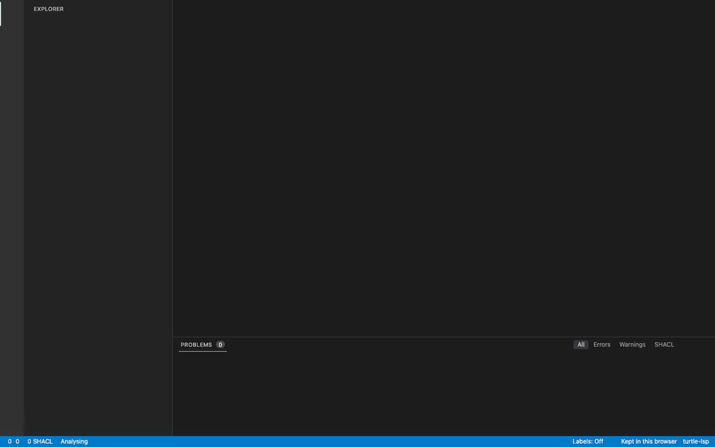
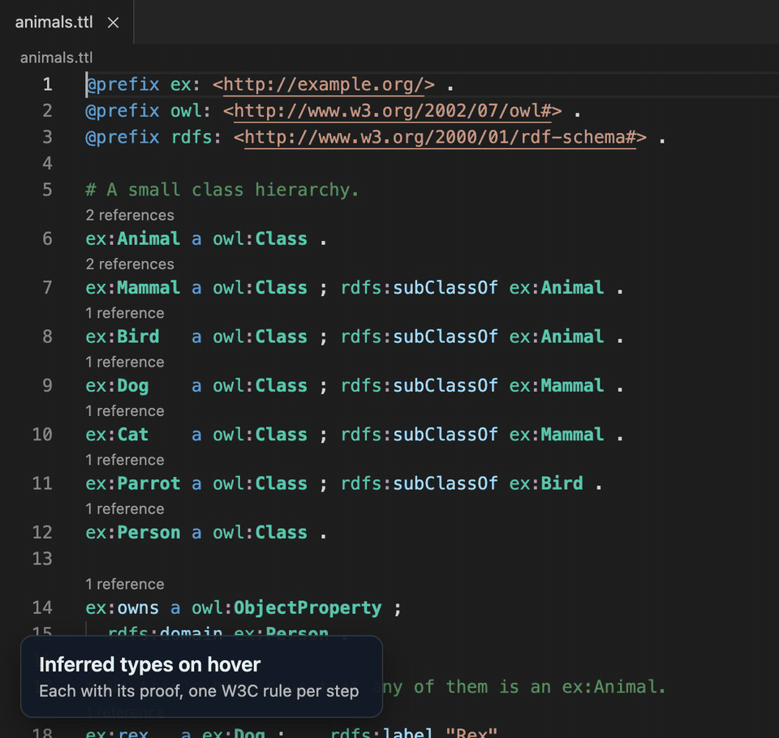
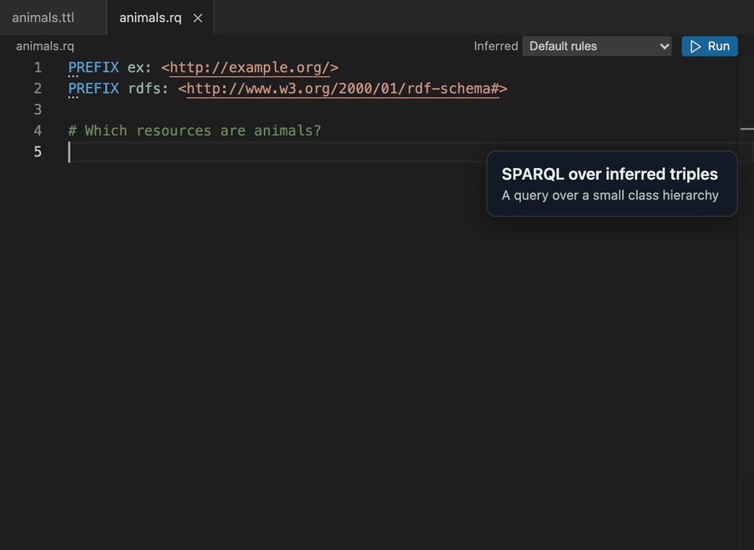
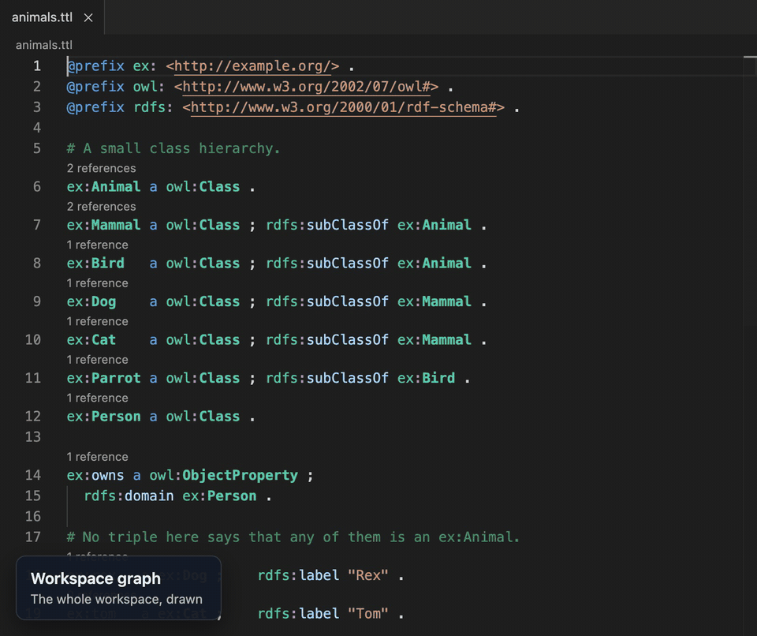

<p align="center"></p>

<p align="center"><a href="https://github.com/abhishekkundu25/turtle-lsp/actions/workflows/ci.yml"></a> <a href="LICENSE"></a> <a href="#tested-against-the-real-world"></a> <a href="#tested-against-the-real-world"></a> <a href="#json-ld"></a> <a href="#tested-against-the-real-world"></a> <a href="#tested-against-the-real-world"></a></p>

# turtle-lsp

A fast language server for RDF Turtle (`.ttl`), written in Rust. It also
reads TriG, N-Triples, N-Quads, JSON-LD, RDF/XML (Protégé's `.owl`), OWL
Functional syntax (`.ofn`) and OWL/XML (`.owx`), and SPARQL queries and
updates.

A keystroke in a 30,000-line file gets fresh diagnostics in about 5 ms, and
the whole file formats in about 5 ms. The server starts in a few milliseconds.

**[Try it in your browser](https://abhishekkundu25.github.io/turtle-lsp/)**: the same server, compiled to
WebAssembly, in an editor that runs entirely in the tab. Nothing is uploaded.

<p align="center"></p>

**Reasoning**: [TurbOWL](https://github.com/abhishekkundu25/turbowl), an OWL 2 RL
reasoner, works out what the workspace implies, in the background; it is on
by default. Hover on a resource lists its inferred types, each with its
proof: one W3C rule per step, each triple it rests on a link to its line.
With `turtle.reasoning.diagnostics` on, contradictions such as a member of two
disjoint classes are diagnostics. With `turtle.query.reasoning` set to
`default` or `complete`, SPARQL queries run over the inferred triples too.

<p align="center"></p>

It is the only Turtle language server we know of that checks itself against
the full W3C test suites and real public ontologies; see
[Tested against the real world](#tested-against-the-real-world).

## What each file gets

| | Turtle, TriG | N-Triples, N-Quads | JSON-LD | RDF/XML | OWL Functional | OWL/XML | SPARQL |
|---|---|---|---|---|---|---|---|
| Errors, hover, definition, references, outline, folding | ✓ | ✓ | ✓ | ✓ | ✓ | ✓ | ✓ |
| Its data read by reasoning, SHACL validation and queries | ✓ | ✓ | ✓ | ✓ | ✓ | ✓ | |
| Label, house-style and SHACL checks | ✓ | ✓ | ✓ | | | | |
| Prefix checks | ✓ | | ✓ | | | | ✓ |
| Completion | ✓ | | ✓ | ✓ | ✓ | ✓ | ✓ |
| Rename | ✓ | ✓ | ✓ | ✓ | | | ✓ |
| Formatting, quick fixes | ✓ | ✓ | ✓ | | | | ✓ |
| Label hints | ✓ | ✓ | ✓ | | | | ✓ |
| Semantic colours | ✓ | ✓ | | | | | ✓ |
| Run the query over the workspace | | | | | | | ✓ |

A rename of a term that an OWL Functional or OWL/XML file uses is refused,
and names the file. Protégé and ROBOT own the layout of OWL files, so
nothing reformats them.

## Features

- **Diagnostics**: syntax errors with recovery (one mistake does not hide the rest of the file; past 1,000 in one file, the editor shows the first 1,000 and one error that says there are more, and `turtle-lsp check` reports them all), undeclared/unused/duplicate prefixes, unknown or deprecated terms of well-known vocabularies (matched by namespace IRI, with "did you mean"), invalid IRIs and language tags, and ill-typed literals (`"twelve"^^xsd:integer`, `"2021-02-29"^^xsd:date`: a value not valid for its XSD datatype or `rdf:JSON`). With `diagnostics.workspace` on, files that are not open are checked too, in the background, as `turtle-lsp check` checks them.
- **Completion**: after `prefix:`, terms of that namespace from 80+ bundled vocabularies and from your workspace, ranked by position (classes after `a`, properties in predicate position). Properties a SHACL shape requires for the subject's class come first ("required by …"), then properties whose `rdfs:domain` fits; after a property, instances of its range (or `sh:class`) come first and `sh:in` values are offered. Typing a bare local name (`Pers`) finds `foaf:Person`. Completing a well-known prefix that is not declared adds its `@prefix` line.
- **Hover**: label, comment, types and where a term is described.
- **Navigation**: go to definition (where a resource is the subject), type definition (the resource's class), implementation (a class's instances and subclasses), references, rename across files, document highlight. On the prefix part of `ex:a`, these work on the prefix. A rename's new name reads the same in every file: a local name, `prefix:local`, `<IRI>`, or a bare absolute IRI (with `://`, or a scheme that is no declared prefix, as `urn:ex:a`). "N references" above each subject a file describes (code lenses; `codeLens.references` turns them off).
- **Semantic highlighting and label hints**: IRIs are coloured by what they denote (class, property, individual, datatype), and an opaque name such as `ex:P0042` can show its label after it.
- **Outline and search**: document symbols, workspace symbols, folding.
- **Formatting**: one consistent layout for Turtle, TriG, N-Triples and N-Quads, built from the tokens: comments and statement order are kept, the graph never changes, and formatting twice changes nothing. Files with syntax errors are left alone.
- **Quick fixes and refactorings**: add a missing prefix (your project's own binding first), add all missing prefixes, remove an unused prefix, fix a misspelled term; organise prefixes, shorten or expand an IRI, and extract a prefix for a repeated namespace.
- **Type hierarchy**: super- and subclasses (and sub-properties) across the workspace, imports and vocabularies.
- **Workspace graph** (VS Code and the browser editor): the whole workspace as one graph, with filters, search, a focus view of a node's neighbours and a class tree; click a node to go to its definition. Built on `turtle/graph`, a custom request other clients can send too (listed under `experimental` capabilities).
- **Queries for other extensions and tools**: `turtle/query`, a custom request (listed under `experimental` capabilities) that runs a SPARQL query given as text over the workspace as the editor has it and answers SPARQL 1.1 Query Results JSON. See [Queries from another extension or tool](#queries-from-another-extension-or-tool-turtlequery).
- **Lints**: terms used in one of your own namespaces but described nowhere (with "did you mean"), and SHACL shapes as you type: a property shape without `sh:path`, an unknown `sh:class`, a non-datatype `sh:datatype`, parameters a node shape cannot have, dangling shape references, `sh:minCount` above `sh:maxCount`.
- **Label checks** (warnings, on by default): two terms of one kind (two classes, two properties or two concepts) in the workspace with the same `rdfs:label` or `skos:prefLabel` in one language, ignoring case (`duplicate-label`, on both labels, naming the other term); a label with whitespace at either end (`label-whitespace`, with a fix that trims it); a term with two labels in one language (`multiple-labels`). A use of a term that a workspace file marks `owl:deprecated true` is a `deprecated-term` warning; deprecated terms of bundled vocabularies and imports stay hints.
- **House-style checks** (warnings, off until `lint.enable` lists them): `missing-label`, `missing-definition` (neither `skos:definition` nor `rdfs:comment`), `multiple-definitions`, `duplicate-definition`, `lowercase-definition`, and on each `owl:Ontology`, `missing-ontology-title`, `missing-ontology-description` and `missing-ontology-license`. They look at classes, properties and concepts only, not instance data. `lint.ignore` turns any check off; see [Settings file](#settings-file-turtle-lspjson).
- **Imports**: `owl:imports` of an ontology in the workspace just work; others resolve through a Protégé `catalog-v001.xml` or the import cache, or (with `turtle.imports.network` on) are fetched once and cached. Imported terms (Turtle, TriG, N-Triples, N-Quads, JSON-LD, RDF/XML, OWL Functional syntax or OWL/XML, followed up to 5 levels deep) feed hover, completion and lints; definition and "Described in" on a term of a local RDF/XML, Functional or OWL/XML import open its line in the real file. An import in Manchester syntax gets a message naming the format and how to save it as RDF/XML or Turtle in Protégé, and an RDF/XML, Functional or OWL/XML import with an error part way through gets an `import-truncated` warning with the line and column. An import that can't be resolved gets an information diagnostic saying how to resolve it, with a quick fix that fetches that one web import and caches it, even with the setting off. Go to definition on an imported term opens the cached copy, which is read-only: it gets no diagnostics. While an import is unresolved, SHACL results it could change are warnings with a note; `imports.unresolved: "ignore"` keeps them at full severity, for projects that validate without their imports on purpose. See [Network access](#network-access) for what is fetched and the limits.
- **Turtle 1.2**: triple terms `<<( )>>`, reified triples `<< >>`, `~` reifiers, `{| |}` annotations, `@lang--dir`, `VERSION`.
- **TriG, N-Triples and N-Quads**: `.trig`, `.nt` and `.nq` files get the same features. See [TriG, N-Triples and N-Quads](#trig-n-triples-and-n-quads).
- **SPARQL**: `.rq`, `.sparql` and `.ru` files (queries and updates, SPARQL 1.1 and 1.2) get the same knowledge of the workspace and the vocabularies: diagnostics, completion, hover, navigation, rename, formatting and quick fixes. The SPARQL queries of SHACL shapes (`sh:select`, `sh:ask`, `sh:construct`, `sh:update`) get SPARQL highlighting, completion and hover inside the string. See [SPARQL](#sparql).
- **JSON-LD**: `.jsonld` files (JSON-LD 1.1) join the workspace: their terms count in Turtle and SPARQL files, SHACL shapes validate their data with results on the key or value, and they get JSON syntax, context, undefined-key, IRI and language-tag diagnostics, plus completion, navigation, rename, formatting and semantic tokens inside the file. See [JSON-LD](#json-ld).
- **RDF/XML (`.owl`, `.rdf`)**: Protégé's files join the workspace: their terms count everywhere, `check`, `query`, reasoning, SHACL and the graph read them, and inside the file you get hover, definition, references, rename, outline, folding and diagnostics at the exact attribute or name. Rename is the only feature that writes RDF/XML: it edits each use in its own form, or refuses the whole rename and says where and why. No formatting, completion or quick fixes in it. See [RDF/XML and Protégé files](#rdfxml-and-protégé-files-owl-rdf).
- **OWL Functional syntax (`.ofn`, or a `.owl` that holds it)**: the OBO edit files ROBOT and Protégé write are read as RDF/XML files are: their axioms become RDF triples by the W3C mapping, so their terms count in other files, and hover, definition, references, the outline, `query`, SHACL and reasoning see them. Each error is at its exact span (`ofn-syntax`), in the editors and in `check`. Completion offers the keywords and terms the grammar takes at the cursor; nothing else writes Functional syntax, rename included. See [OWL Functional syntax](#owl-functional-syntax-ofn).
- **OWL/XML (`.owx`, or a `.owl` that holds it)**: read as Functional syntax is, by the same W3C mapping, so the same features see it. Errors are at their exact spans (`xml-syntax`, `owx-syntax`), and an axiom with an error is left out. Nothing writes OWL/XML, rename included. See [OWL/XML](#owlxml-owx).
- **Conformance**: W3C Turtle, TriG, N-Triples and N-Quads test suites, RDF 1.1 and 1.2: 1137/1137 pass (`tests/w3c_conformance.rs`); W3C SPARQL 1.1 and 1.2 syntax suites: 425/426 (`tests/w3c_sparql.rs`); W3C SPARQL 1.1 query evaluation through the query engine: 176 of the 183 tests in scope (`tests/w3c_sparql_eval.rs`); W3C JSON-LD 1.1 toRdf, expand and remote-doc suites: every test in scope but two (`tests/w3c_jsonld.rs`, see [JSON-LD](#json-ld)); W3C RDF/XML suite: 166/166 (`src/rdfxml/grammar.rs`); the Functional-Syntax inputs of the approved W3C OWL 2 test cases: 78/78 parse with no error (`src/ofn/tests.rs`), and the 57 of them with an RDF/XML text of the same ontology give its graph, but for 6 where the two texts differ (`tests/ofn_oracle.rs`).
- **SHACL validation**: on save, and about a second after you stop typing, the workspace is validated against its SHACL shapes in the background (Turtle files together; each TriG or N-Triples dataset with them, never merged with another dataset) (SHACL Core and SHACL-SPARQL; W3C suites 98/98 and 23/23, `tests/w3c_shacl.rs`). Results appear on the offending triple, with the shape as related information. Settings `turtle.shacl.enabled`, `turtle.shacl.maxTriples` (default 2,000,000: the most triples one run validates, the shared triples and every dataset together) and `turtle.shacl.onType` (validate while typing; on by default). What validation could not check is reported, not passed over: a failed SHACL-SPARQL query or a check cut short is a `shacl-failure` warning, and a shape whose `sh:path` cannot be read is a `shacl-invalid-path` error.
- **Reasoning** (on by default, with TurbOWL's default rules; `turtle.reasoning.rules` = `off` turns it off): TurbOWL, an OWL 2 RL reasoner, works out what the workspace and its imports imply, in the background after open, save and a pause in typing. Hover on a resource lists its inferred types under "Inferred", each with its proof: one W3C rule per step, each triple it rests on a link to its line. With `turtle.reasoning.diagnostics` on (off by default, since SHACL shapes often check the same rules), TurbOWL's findings, such as a member of two disjoint classes, are diagnostics on the term at fault, each triple of the proof a link to its line (`turbowl/<rule>`). `default` runs TurbOWL's default rules; `complete` runs every W3C OWL 2 RL rule and is slower. `turtle.reasoning.maxTriples` (default 2,000,000) is the most triples a run reads; past it, reasoning is skipped with a note. It also bounds the inferred triples read for hover: past it, hover says the list may be incomplete. An edit stops the run going on, and a run stops after 10 s; either way hover keeps the last result, and a stop at the time limit is reported (once as a message, then in the log) until a run finishes. Edits to SPARQL files do not rerun reasoning.

## Tested against the real world

Every release is checked against the official W3C test suites and against
public RDF files anyone can download (`npm run corpus`).
`npm run corpus` downloads over `https` only and fails when a download
fails. A file whose SHA-256 differs from the checksum recorded in
`tools/corpus` gets a warning, or fails the run with `CORPUS_STRICT=1`.

| Check | Result |
|---|---|
| W3C Turtle, TriG, N-Triples and N-Quads suites | 1137 / 1137 |
| W3C SPARQL 1.1 and 1.2 syntax suites (query, update, federation) | 425 / 426 ¹ |
| W3C SPARQL 1.1 query evaluation (aggregates, BIND, CONSTRUCT, EXISTS, functions, grouping, negation, property paths, subqueries) through the query engine | 176 / 183 in scope (7 known failures in spareval 0.2.7; 21 out of scope: named graphs, RDF/XML data) |
| W3C SHACL Core suite | 98 / 98 |
| W3C SHACL-SPARQL suite | 23 / 23 |
| W3C JSON-LD 1.1 suites: toRdf, expand, remote-doc | 443, 365 and 6 pass; 2 known failures; the rest out of scope ³ |
| JSON-LD on 364 public documents (schema.org examples, ActivityStreams, Verifiable Credentials 1.0 and 2.0, IIIF, DCAT-US, Croissant, GS1, DID) vs. [oxjsonld](https://crates.io/crates/oxjsonld) | Same graph for 339; the other 25 are known differences where oxjsonld departs from JSON-LD 1.1 ⁴ |
| W3C RDF/XML suite (RDF 1.1) | 166 / 166 |
| RDF/XML parser vs. [oxrdfxml](https://crates.io/crates/oxrdfxml) on FOAF, BFO, RO and PATO (270,000 triples) | Same graph on BFO, RO and PATO. FOAF differs in two `rdfs:comment` values, where XML 1.0 (3.3.3) makes a line end in an attribute a space and oxrdfxml keeps it. Every such case and its spec rule is listed in `src/rdfxml/grammar.rs` |
| Parser vs. [Oxigraph](https://github.com/oxigraph/oxigraph) on public files (schema.org, Wikidata, DBpedia, QUDT, Brick, Gene Ontology, W3C vocabularies, a Web Data Commons N-Quads dump) | Same quads in 98 of 99 cases (2.56 million triples) ² |
| Formatter on the same files | Never changed a graph, never dropped a comment; formatting twice changes nothing |
| SPARQL on 1,317 real queries ([SIB sparql-examples](https://github.com/sib-swiss/sparql-examples): UniProt, Rhea, Bgee, neXtProt, ...) | Same verdict as [spargebra](https://crates.io/crates/spargebra) on all; the formatter kept every query's algebra and comments, and formatting twice changes nothing |
| Gene Ontology (118 MB, 1.28 million triples) | Parsed in 0.4 s, formatted in 0.8 s |
| Fuzz testing (`tests/chaos.rs`) | On every CI run (Linux and Windows; nightly 200,000 with a new seed), 30,000 randomly damaged Turtle, TriG, N-Triples and N-Quads files (SHACL shapes with SPARQL among them), 30,000 JSON-LD documents, 30,000 SPARQL queries and updates, and damaged RDF/XML, OWL Functional and OWL/XML documents, with every editor feature run on each, without a crash |
| Resource checks | No CPU use while idle, no server left running after the editor quits |

¹ The one left is a SPARQL 1.2 proposal (a projected variable reused in a
later `SELECT` expression) that the SPARQL parser library rejects.
² The other is the Web Data Commons slice: 26 of its 57,000 lines have a `[`
inside an IRI, which Oxigraph rejects and turtle-lsp accepts.
³ See [Conformance](#conformance) under JSON-LD.
⁴ Listed with the reasons in `tests/jsonld_oracle.rs`; see
[Conformance](#conformance) under JSON-LD.

## Performance

Benchmark: one 30,005-line file (5,000 resources) open in a workspace of 200
other Turtle files (40,000 more resources). The client is a script that talks
to the server over stdio, the way an editor does. Times are end to end,
including JSON encoding and the pipe.

| | Previous Node.js server | turtle-lsp (Rust) | Speedup |
|---|---:|---:|---:|
| Keystroke → diagnostics, median | 4,911 ms | **4.3 ms** | ~1,100× |
| Keystroke → diagnostics, p95 | 8,341 ms | **4.8 ms** | ~1,700× |
| Start-up (`initialize`) | 2,537 ms | **1.3 ms** | ~2,000× |
| Open file → first diagnostics | 1,884 ms | **5.7 ms** | ~330× |
| Completion after `foaf:` | 21 ms | **0.2 ms** | ~100× |
| Completion with nothing typed | 476 ms, 48,203 items, 9.5 MB | **0.1 ms**, 6 items, 1 KB | |
| Go to definition | 0.1 ms, 7 locations (every use) | **0.1 ms**, 1 location (the definition) | |
| Format the whole file | — | **4.6 ms** | |
| Semantic tokens, whole file | — | **3.6 ms** | |
| Save → SHACL results (~180k triples) | — | **9.8 ms** | |
| Memory (resident, after indexing, opening and editing) | 959 MB | **144 MB** | ~7× less |

JSON-LD against Turtle of the same length (about 30,000 lines each; the
JSON-LD file has 1,499 people under an inline `@context`), each opened alone
in an empty workspace:

| | Turtle | JSON-LD |
|---|---:|---:|
| Open file → first diagnostics, median | 4.9 ms | **6.2 ms** (1.27×) |
| Keystroke → diagnostics, median | 4.2 ms | **6.1 ms** |
| Hover | 0.1 ms | **0.1 ms** |

The JSON-LD budgets are opening within 3× the Turtle time and a keystroke
under 10 ms; `npm run bench` reports both. `tests/jsonld_budget.rs` holds
release builds to the first, and to a keystroke within 2× the Turtle opening
time, which carries across machines.

Memory on large inputs: after 20 `documentSymbol` requests on a
100,000-triple file (a 5.5 MB answer each), the server holds 113 MB, 1.07
times what it held before the first request. `turtle-lsp format --check` on
a 2.5 MB file peaks at 88 MB resident, 35 bytes per input byte (142 MB
committed, 57 bytes per byte), and so does `turtle-lsp check --no-shacl`.
`npm run bench` fails when either commits more than 64 bytes per input byte
(0.7.1: 88). It checks the committed figure because the resident one depends
on the system: Linux reports about 40% more for the same commit.

Measured with `npm run bench` at commit 15bd504 on an Apple M6 (12 cores)
with macOS 27.0: the median of three runs, load average 1.7 to 1.8. Results
vary a little between runs. The
bench also has stress rows (near-miss IRIs, a 2.4 MB file, typed completion
over 40,000 subjects, 200 TriG datasets, `check` on the workspace); CI runs
it on every push to main, every pull request and nightly (see [Performance in CI](#performance-in-ci)).

Why it is fast:

- **One parse per edit.** Each document version is parsed once, by a
  hand-written lexer and parser, and every feature reads that result. The
  previous server parsed each document about seven times per keystroke.
- **Batched edits.** The server reads every queued message before it computes
  diagnostics, so a burst of keystrokes costs one analysis.
- **Edits cost the size of the edit.** After an edit in a Turtle, TriG,
  N-Triples or N-Quads file, the server parses again only the statements
  around it and splices them into the parse it has, updates the workspace
  index by the difference, and checks again only the statements and terms
  the edit can change. The result is the same as a full parse, which the
  tests check on every edit of the chaos tests and on the public corpus.
  Keystroke to diagnostics, median, against the release before: 13.4 to
  4.9 ms on a 2.4 MB data file, 16.1 to 6.1 ms on a 2.4 MB vocabulary,
  3.9 to 1.5 ms on the 30,000-line file (edits sent as ranges, as editors
  send them).
  `parse.incremental: false` parses every edit in full.
- **Small replies.** Completion returns at most 200 ranked items and loads
  their documentation only when you select one.
- **Background indexing.** Workspace files are parsed in parallel on a
  separate thread, so start-up does not wait for them.
- **Embedded vocabularies.** `data/vocab.tsv` has 81 namespaces and 24,140
  terms (`grep -c '^@ns' data/vocab.tsv` counts the namespaces). They are
  compiled into the binary and parsed only when first used. Where each one
  comes from is under [Vocabulary data](#vocabulary-data).

## Project prefixes

Turtle files often leave out their `@prefix` lines and rely on a shared header.
Put the header in a `prefixes.ttl` file: every Turtle file in that directory or
below it can use those prefixes. You can also set prefixes in
[`turtle-lsp.json`](#settings-file-turtle-lspjson) or pass them from the editor:

```lua
init_options = { prefixes = { ex = "http://example.org/" } }
```

## TriG, N-Triples and N-Quads

The server also reads TriG (`.trig`), N-Triples (`.nt`) and N-Quads (`.nq`)
files. It takes the language from the editor's language id (`turtle`, `trig`,
`ntriples`, `n-triples`, `nquads` or `n-quads`). If the editor sends another
id, the file extension decides.

- **TriG**: graph blocks `{ ... }`, `ex:g { ... }` and `GRAPH ex:g { ... }`.
  Triples outside a block are in the default graph. Go to definition on a
  graph name finds its blocks and the statements about it. The outline shows
  each block with its subjects, and blocks fold. A `prefixes.ttl` applies to
  TriG files as it does to Turtle files.
- **N-Triples**: one triple per line with full IRIs. The server reports
  everything N-Triples does not allow as an error: directives, prefixed names,
  `a`, `;` and `,`, `[ ]`, collections, unquoted numbers and booleans, single
  quotes and long strings, relative IRIs, reified triples and annotations.
  RDF 1.2 triple terms `<<( s p o )>>` are allowed. N-Triples files get no
  prefixes from `prefixes.ttl` or the editor settings.
- **N-Quads**: N-Triples plus an optional graph label (an IRI or a blank node)
  before the final `.`. Everything said about N-Triples above applies. A graph
  label that is not an IRI or blank node, or a fifth term, is an error. The
  outline groups statements by graph, and formatting writes one quad per line.
  The quads join the workspace like a TriG file's, so terms described in a
  `.nq` file count as described.

The workspace index covers `.ttl`, `.turtle`, `.trig`, `.nt`, `.nq` and
`.jsonld` files.

## SPARQL

SPARQL files (`.rq`, `.sparql`, `.ru`; language id `sparql`) get the
language-server features of Turtle files, built on the same knowledge of the
workspace and the vocabularies. Queries and updates, SPARQL 1.1 and 1.2, are
accepted in any of these files: the server checks a document as what it holds,
not by its extension.

<p align="center"></p>

- **Diagnostics** as you type: syntax errors at the token where the query
  stops making sense, undeclared, unused and duplicate prefixes, unknown or
  deprecated vocabulary terms with "did you mean", terms in your own
  namespaces that nothing describes (`turtle.lint.undescribedTerms`), and a
  projected variable that the `WHERE` clause never binds.
- **Completion** of keywords by context, variables after `?` or `$`,
  prefixes, terms (classes after `a`, properties in predicate position,
  properties whose `rdfs:domain` fits first) and built-in functions.
  Accepting a term whose prefix is not declared adds its `PREFIX` line.
- **Hover** and **label inlay hints** as in Turtle.
- **Navigation**: go to definition (a term to where the workspace describes
  it, a prefix to its `PREFIX` line, a variable to its first occurrence in
  its scope), references (a term's uses in the workspace too), document
  highlight.
- **Rename** of variables (within their scope, keeping `?` or `$`), prefixes,
  and terms: renaming a term in a Turtle file also renames it in the
  workspace's SPARQL files, and the other way round.
- **Formatting** that indents groups, puts one triple pattern per line,
  aligns the `PREFIX` block and keeps comments. The formatted query must
  parse to the same algebra, or nothing changes. Queries with syntax errors
  are left alone.
- **Quick fixes and refactorings**: add a missing `PREFIX`, add all missing
  prefixes, remove an unused one, fix a misspelled term, organise prefixes,
  shorten or expand an IRI.
- **Semantic highlighting, folding and outline** (the query form, or each
  update operation, with its clauses).
- **▶ Run query**: a code lens above a query runs it over the workspace's
  files as the editor has them, unsaved edits included (and, with
  `query.reasoning` set to `default` or `complete`, over the workspace's
  external imports and everything TurbOWL infers from that same list too,
  without a filter; the results say how many). VS Code on desktop and web
  shows a Query Results panel beside the query. Each query file has one
  panel; rerun updates it. The header shows rows, time, files read and the
  inferred-triples note. The Inferred choice starts at
  `turtle.query.reasoning` and offers Off, Default rules and Complete rules.
  Use Rerun, Copy (TSV) or Export CSV / JSON. The table sorts by column and
  shortens IRIs with the query's prefixes, with the full IRI on hover.
  ASK shows `true` or `false`; CONSTRUCT shows triples. The panel shows
  errors with line and column, Running… and Cancelled states.
  Other editors get a Markdown document through `window/showDocument`.
  The `turtle.runQuery` command takes the query URI as its first argument.
  Every client can pass an optional second argument
  `{"reasoning": "off"|"default"|"complete"}` to choose reasoning for one run.
  The query runs on its own thread with a time limit and
  a row limit (`query.timeoutSeconds`, default 30; `query.maxRows`, default
  1000), so typing never waits for it. A query that keeps more than
  `query.maxBufferedRows` rows in memory to sort, group, deduplicate or join
  them (default 10 000 000; `0` for no limit) is stopped too. That limit
  counts rows, not bytes: ordinary rows take about 100 bytes each, but a row
  with long text (a `GROUP_CONCAT` result, say) takes more, so memory use can
  pass 1 GB. A query that joins more than 70 patterns or path steps at once
  is refused before it runs. While it runs, an editor that shows progress
  shows "Running <file>" with the seconds so far and a cancel button, and
  an editor that can refresh code lenses shows the lens as
  "■ Cancel query" (the `turtle.cancelQuery` command). Either one stops it,
  including reasoning and reading triples. `turtle.reasoning.maxTriples`
  caps both the input and inferred triples. Over either limit, the query
  runs without inferred triples and says so. The CLI and Run query share
  the note's sentence: "Inferred triples skipped: TurbOWL inferred more
  than N triples, over the reasoning limit." for the inferred cap.

Prefixes from `prefixes.ttl` and `turtle.prefixes` count as declared in
queries too. SPARQL files add nothing to the workspace's knowledge, so a
query never makes a misspelled term look described. A query runs only when
you ask, over the workspace's own files: the default graph is the union of
every triple of every file, named graphs included; `GRAPH` and `FROM NAMED`
match nothing and `FROM` is ignored. With reasoning on, the graph also
includes the workspace's external imports and all inferred triples.
Updates are never run and no endpoint is contacted.

### Queries from another extension or tool: `turtle/query`

A client that is not an editor (another extension, a tool that reuses the
running server) sends the custom request `turtle/query`, listed under the
server's `experimental` capabilities, with the query as text:

```json
{ "query": "SELECT ?s WHERE { ?s a <http://example.org/Pump> }",
  "files": ["file:///w/data.ttl", "file:///w/model.ttl"],
  "base": "file:///w/", "timeoutSeconds": 10, "maxRows": 1000,
  "reasoning": "default" }
```

Only `query` is required. `files` limits the data to those documents
(default: every RDF document of the workspace, open ones as the editor has
them). `reasoning` is `off`, `default` or `complete`, defaulting to
`query.reasoning`. With `default` or `complete`, those documents plus the
workspace's external imports are both the reasoning input and the queried
data, with all TurbOWL's inferred triples added without a filter. With
`files`, other workspace documents take no part. With `off`, imports and
inferred triples are excluded. `timeoutSeconds` can only lower
`query.timeoutSeconds`: `0` or a higher value is the setting. `maxRows`
can only lower `query.maxRows` in the same way; `query.maxBufferedRows`
applies as always. The query can use the prefixes of `prefixes.ttl` and
the `prefixes` setting without declaring them, as a query file beside the
first of `files` (default: in the workspace root) gets them. The dataset is the one of ▶ Run query: the union of every triple of
every file, with no named graphs.

The answer is `{"kind": "select", "head": …, "results": …, "omitted": n,
"elapsedMs": ms}` (SPARQL 1.1 Query Results JSON, full IRIs, `omitted` the
rows past `maxRows`), `{"kind": "ask", "head": {}, "boolean": b,
"elapsedMs": ms}`, or for CONSTRUCT and DESCRIBE `{"kind": "construct",
"triples": [{"subject", "predicate", "object"}], "omitted": n, "elapsedMs":
ms}` with the terms in the results JSON's term form. Nothing is shown and no
file is written.

With reasoning on, the answer also has an `inferred` member:

- `{"rules": "default" | "complete", "triples": n, "findings": k}` gives
  the inferred triples added and the findings TurbOWL reported. Findings do
  not stop the query.
- `{"skipped": {"triples": n, "limit": m}}` means the documents and imports
  exceeded `turtle.reasoning.maxTriples`; no inferred triples were added.
- `{"skipped": {"inferred": true, "limit": m}}` means TurbOWL inferred more
  than that limit; no inferred triples were added.

With `off`, there is no `inferred` member. Time limits and cancellation
stop reasoning and reading triples as well as evaluation.

A query that is not SPARQL, an update, a relative IRI
without `base`, an empty `files`, a `files` entry that is no workspace
document, or an invalid `reasoning` value is an `InvalidParams` error.
A query stopped at a limit is a `RequestFailed` error with the reason as its message. The
query runs on a thread of its own, and `$/cancelRequest` stops it (a
`RequestCanceled` error); `shutdown`, `exit` and a closed connection stop
every run. At most four queries run at a time; one more is a
`RequestFailed` error, to send again when one has answered.

### SPARQL in SHACL shapes

The query in a `sh:select`, `sh:ask`, `sh:construct` or `sh:update` string
of a Turtle or TriG file is a SPARQL query for the editor too:

```turtle
ex:S sh:sparql [ sh:prefixes ex:P ; sh:select """
    SELECT $this WHERE { FILTER NOT EXISTS { $this ex:next ?n } }
""" ] .
```

- **Semantic highlighting** as in a `.rq` file: keywords, variables,
  functions, prefixes and terms.
- **Completion** of SPARQL keywords, the query's variables after `?` or `$`,
  prefixes and terms. The query's prefixes are the ones its `sh:prefixes`
  declare with `sh:declare` (in this file, in the ontologies it
  `owl:imports`, or wherever the workspace describes them), as for the
  checks below; the file's own `@prefix` lines do not count, unless a
  `sh:prefixes` value is declared nowhere.
- **Hover** on prefixes and terms.
- **Checks** of `sh:select` and `sh:ask` queries as you type: syntax errors
  at the token, prefixes the query does not declare
  (`shacl-sparql-syntax`, `shacl-sparql-prefix`), and the constructs
  SHACL-SPARQL forbids with pre-bound variables (`shacl-sparql-unsupported`:
  `MINUS`, `VALUES`, `SERVICE`, `AS $this`, a subquery that drops `$this`).

VS Code and the browser editor show suggestions as you type in Turtle and
TriG strings (`editor.quickSuggestions` with `"strings": "on"` for
`[turtle]` and `[trig]`); other editors may need their own setting for
completion inside strings.

## JSON-LD

JSON-LD 1.1 files (`.jsonld`, language id `jsonld`) are RDF like the other
formats. Plain `.json` files are not read, even with an `@context`.

- **Diagnostics**: JSON syntax errors at the exact position, with recovery
  (`json-syntax`); invalid `@context` definitions, cycles, redefined
  protected terms and contexts that cannot be loaded (`jsonld-context`); a
  key the context does not define, which JSON-LD silently drops
  (`jsonld-undefined-term`, a warning); invalid IRIs and malformed language
  tags at the value (`invalid-iri`, `invalid-language-tag`). The vocabulary
  lints apply to IRIs reached through the context: `unknown-term` with "did
  you mean", `deprecated-term`, and `undescribed-term` for your own
  namespaces.
- **One workspace**: classes and properties a JSON-LD file describes are
  known in Turtle and SPARQL files (completion, hover, references, no
  `undescribed-term`), and the other way round. `owl:imports` of an ontology
  declared in JSON-LD resolve.
- **SHACL**: Turtle shapes validate JSON-LD data, and shapes written in
  JSON-LD are used. Each result is on the key, value or `@id` that breaks
  the shape, or on the opening brace of a node without an `@id`. Named graphs (`@graph` with `@id`) follow the TriG rules.
- **Completion**: in a key, the terms of the context in force at the cursor
  (scoped contexts included), properties the workspace describes under
  `@vocab`, and `prefix:local` names; in an `@type` value, classes the same
  way. It works in half-typed JSON. Completing `prefix:` for a known prefix
  the context lacks also adds it to the `@context` (an idea from
  [SWLS](https://github.com/SemanticWebLanguageServer/swls)).
- **Navigation**: hover on a key shows its expanded IRI, and on an `@type`
  value also what the workspace says about it. Go to definition on a term
  goes to its `@context` entry, in the file or in a context file of the
  workspace; on a term of a bundled or remote context, or a key `@vocab`
  maps, it goes to where the workspace describes the IRI. References and
  highlights on a term list its definition, its uses and the IRI's uses in
  other files.
- **Rename**: renaming a term or a keyword alias changes its `@context` entry
  and every use, and nothing else. Renaming an IRI, from any file, rewrites
  each JSON-LD use in its own form: compact, `@vocab`-relative, relative to
  `@base`, absolute, or the term definition it comes through. A rename that
  cannot be written safely is refused with the reason.
- **Formatting**: the layout of `JSON.stringify` with the editor's indent;
  numbers, escapes and key order are kept, and the result must be the same
  JSON value. A file with JSON syntax errors is not formatted.
- **Semantic tokens and outline**: keywords and aliases, properties and
  classes get their own colours; the outline lists node objects by `@id` and
  nests a named graph's nodes under the graph.
- **Command line**: `turtle-lsp check` checks `.jsonld` files with the same
  codes, positions, exit codes and JSON and SARIF output as Turtle files, and
  `turtle-lsp format` formats them.
- **Browser**: the [browser editor](https://abhishekkundu25.github.io/turtle-lsp/)
  gives JSON-LD files the same diagnostics and SHACL results. It uses the
  bundled contexts and contexts in other files of the workspace, and never
  fetches one.

**Contexts.** A remote `@context` is loaded, in order, from a file in the
workspace (a relative reference), the import cache, then the contexts bundled
with the server: schema.org, ActivityStreams, Verifiable Credentials v1 and
v2, and DID v1 (`data/jsonld-contexts`). The network is off by default, so
opening a file never goes online; a context that cannot be loaded is a
`jsonld-context` error at its URL. Turn the network on with the
`imports.network` setting (`turtle.imports.network` in VS Code) or `--network`
on the command line; [Network access](#network-access) has the rules every
fetch follows. A fetched context goes into the import cache and is read
from there afterwards, network or not. Processed contexts are kept in memory,
so re-checking a document processes only its inline contexts.

**Not supported**: compaction, flattening, framing, converting between
JSON-LD and Turtle, `.json` files, and editing bundled or remote contexts.

### Conformance

The W3C JSON-LD 1.1 API suites, run offline by `tests/w3c_jsonld.rs`, with a
status per test in `tests/w3c/jsonld/expected-status.tsv`:

| Suite | Pass | Known failure | Out of scope |
|---|---:|---:|---:|
| toRdf | 443 | 0 | 24 |
| expand | 365 | 2 | 19 |
| remote-doc | 6 | 0 | 12 |

- **Out of scope:** tests for JSON-LD 1.0 only (`specVersion` or
  `processingMode` `json-ld-1.0`; 37 tests), options the engine does not have
  (`expandContext`, 2; `rdfDirection`, 4), and remote-doc tests about loading
  the input document itself (HTTP `Link` headers, HTML, content types,
  missing documents; 12). The compact, flatten, frame, fromRdf and HTML suites are not run.
- **Known failures:** both are in how the test runner reads the expected
  expanded output (a number serde_json rounds differently, and a node with
  `"@id": null`); the same inputs pass in the toRdf suite.

On 364 public JSON-LD documents from schema.org, ActivityStreams, Verifiable
Credentials 1.0 and 2.0, the IIIF cookbook, DCAT-US, Croissant, GS1 and DID
(sources and licences in `tools/corpus/jsonld-sources.tsv`), the graph of
339 is isomorphic to [oxjsonld](https://crates.io/crates/oxjsonld)'s
(`tests/jsonld_oracle.rs`). The other 25 are known differences, each checked
against the JSON-LD 1.1 spec:

- 20 IIIF manifests with template `@id`s (`{{ id.url }}`): JSON-LD drops those
  nodes, and oxjsonld still emits the list triples of their `@list` values;
- 3 Verifiable Credentials where oxjsonld does not wrap an `@id`-coerced value
  of an `@graph` container in a graph object;
- 1 Verifiable Credential where oxjsonld keeps `@direction` as an RDF 1.2
  directional string, which JSON-LD 1.1 toRdf drops;
- 1 DCAT-US dataset where oxjsonld emits a triple from the value of a key no
  context defines.

`tests/jsonld_lints.rs` checks that the same documents get only the JSON-LD
and vocabulary lints listed there, each checked by hand.

## RDF/XML and Protégé files (`.owl`, `.rdf`)

Protégé saves ontologies as RDF/XML by default, in `.owl` files. turtle-lsp
reads `.owl` and `.rdf` files as workspace files. Only a rename edits them.

- **Which syntax**: the content decides, not the name. RDF/XML is read as
  RDF/XML; a `.owl` that holds Turtle or JSON-LD is read as that. An empty
  `.owl` or `.rdf`, or one of white space only, is RDF/XML (no Turtle
  completion or formatting until Turtle is written in it), and an XML file
  with no root element is an `xml-syntax` error. A `.owl` in OWL
  Functional syntax is read as Functional syntax (see [OWL Functional
  syntax](#owl-functional-syntax-ofn)), and one in OWL/XML as OWL/XML (see
  [OWL/XML](#owlxml-owx)). A `.owl` in Manchester syntax is not read: it
  gets one `unsupported-syntax` diagnostic that names the format and says
  how to save it as RDF/XML or Turtle in Protégé (File > Save as). It is
  an error when an import is read from the file, else a warning.
- **One workspace**: classes and properties an RDF/XML file describes count
  in Turtle, JSON-LD and SPARQL files (hover, completion, no
  `undescribed-term`). `check` and `query` read these files, as do reasoning,
  SHACL (data or shapes), the graph view and the Query Results panel. An
  `owl:imports` of an ontology a workspace file states needs no catalog.
- **Inside the file**: hover, definition, references, the reference lens,
  outline, folding and type hierarchy, each on the exact attribute value or
  qualified name. Diagnostics: XML and RDF/XML syntax errors with recovery
  (`xml-syntax`, `rdfxml-syntax`), SHACL results, reasoning findings, and the
  lints of its terms and literals (`invalid-literal`, `undescribed-term`,
  `unknown-term`, `deprecated-term`), each "did you mean" in the message
  only.
- **Rename edits RDF/XML**: renaming an IRI, from any file, edits the
  RDF/XML workspace files that use it too, and a rename can start inside
  one (on an element name in its start or end tag, an attribute name, an
  `rdf:about`, `rdf:resource` or `rdf:datatype` value, or an `rdf:ID`).
  References and highlights list end tags too. Each use keeps its form: a
  relative value stays relative when the new IRI can be reached from the
  `xml:base` in scope (on the same scheme and host): the shortest relative
  reference that resolves to it, in the old value's style (`#x`, `x`,
  `./x`, `../x`, `/x`, `?q`, `""`) when one does; `&ex;local` keeps its
  entity; a value written with `&amp;` or `&apos;` is written again whole,
  escaped for its quotes; a name keeps its prefix (or takes another prefix
  in scope for the new namespace), and an element's start and end tags
  change together. After the edits, the file must give the same triples
  with the new IRI, or the rename is refused. A use that cannot be
  rewritten exactly refuses the whole rename, with the file, the line and
  the reason: a use read from an entity's replacement text, a value with
  character references (`&#58;`), an IRI the syntax implies (`rdf:li`,
  `rdf:first`, `rdf:nil`, `rdf:Statement`; the message gives the line and
  column of what implies it), and a new namespace with no prefix in scope
  (a rename adds no `xmlns`). A file with a syntax error, or whose DOCTYPE
  gives attributes default values (`<!ATTLIST ... "value">`, which the
  parser does not add), refuses any rename of an IRI its text may spell
  (the full IRI, or its local name), at its first error: the parser may
  not read every use in it. Where a rename could never succeed, whatever
  the new name, prepareRename says so with the same message. Namespace
  prefixes (`xmlns:p`) are not renamed.
  An editor that supports change annotations (VS Code) shows the RDF/XML
  edits for you to confirm first. `rename.rdfXml: false` turns this off: a
  rename that would edit an RDF/XML file is then refused and names it.
- **Nothing else writes RDF/XML**: no formatting, completion, quick fixes
  or `check --fix` on RDF/XML; `format .` passes over it. A `.owl` or
  `.rdf` that holds Turtle or JSON-LD is that syntax: `format`,
  `check --fix` and editors that format it treat it as such (VS Code does
  not offer to format any `.owl` or `.rdf`).
- **Editors**: VS Code, Neovim and the browser editor attach to `.owl`,
  `.rdf` and `.owx` files and leave them in the editor's XML language, with
  its own highlighting. In VS Code a `.owl` opened with no folder does not start the
  extension.
- **Limits**: only UTF-8 is read; a file in another encoding gets an
  `encoding` error, and an import that is not UTF-8 is not read. An XML
  declaration that names another encoding is an `xml-syntax` error, except
  in an ASCII file that names one extending ASCII (US-ASCII, ISO-8859-*,
  windows-125*): its bytes read the same. Files over
  50 MB are not read (the Gene Ontology's 118 MB `go.owl`): `check` reports
  them as it does any file over the limit. A keystroke in PATO (20 MB) takes
  about 90 ms. The browser editor reads files up to 10 MB, in UTF-8 only:
  it names a file it does not read and its first bad byte.
- **XML as the spec reads it**: line ends and attribute values are
  normalized and internal entities expand, nested or holding markup, within
  limits that refuse entity bombs and external entities. Namespace
  declarations follow Namespaces in XML: `xml` and `xmlns` keep their own,
  and an empty prefixed one is an error in XML 1.0.
- **RDF 1.2**: triple terms (`rdf:parseType="Triple"`, `rdf:annotation`,
  `rdf:annotationNodeID`) are read under any `rdf:version` (their grammar
  has no version condition; the version is an announcement); `its:dir` only
  under `1.2` or `1.2-basic`. The withdrawn
  `rdf:bagID`, `rdf:aboutEach` and `rdf:aboutEachPrefix` are errors.

The parser is turtle-lsp's own, so it can place every term and go on after
an error. It passes the W3C RDF/XML suite (166/166) and reads the same graph
as [oxrdfxml](https://crates.io/crates/oxrdfxml) from BFO, RO and PATO. From
FOAF it differs in two comments, where it follows the XML rule for line ends
in attribute values.

## OWL Functional syntax (`.ofn`)

OWL 2 Functional-Style Syntax is what ROBOT and Protégé write for many OBO
edit files (`cl-edit.owl`, `hp-edit.owl`, `ro-edit.owl`). turtle-lsp reads a
`.ofn` file, and a `.owl` whose text starts with `Prefix(` or `Ontology(`,
as Functional syntax, read-only but for completion: nothing formats, fixes or renames it.

- **Read as RDF**: each axiom becomes the RDF triples the W3C [mapping to
  RDF graphs](https://www.w3.org/TR/owl2-mapping-to-rdf/) gives it (an
  annotated axiom with its `owl:Axiom` node, an n-ary axiom as the
  specification's tables say, `owl:AllDisjointClasses` and the like for
  more than two operands), so a Functional file is one more RDF document of
  the workspace. Its classes and properties count in Turtle, JSON-LD and
  SPARQL files (hover with their labels, completion, no `unknown-term`),
  definition on one of its terms opens its `Declaration`, references
  include its uses, and `query`, SHACL validation and reasoning read its
  triples. SWRL rules are written as OWL API writes them (`swrl:Imp`).
- **In the editor**: hover, definition, references, document highlight,
  the outline (each term once, at its declaration; a term the file never
  declares, at the first axiom about it), workspace symbols and folding,
  as for an RDF/XML file; no semantic tokens or inlay hints (the editor's
  grammar colours it). The lints of its terms and literals run on it, at
  the exact text of each IRI: `invalid-literal`, `unknown-term`,
  `deprecated-term`, `undescribed-term`, each "did you mean" in the
  message only.
- **Errors**: every error has the code `ofn-syntax` and its exact span, in
  the editors and in `check` (same exit codes as any syntax: 1 for an
  error). The parse goes on at the next axiom after an error, so each typo
  is one error, and an axiom with an error gives no triples (never a part
  of one); the others are read. Besides the grammar of the [OWL 2
  specification](https://www.w3.org/TR/owl2-syntax/), it reports what the
  specification states that a parser can see: a prefix that is not
  declared or is declared twice with two IRIs, a prefix name with a `:`
  before its end, an IRI that is not an
  absolute IRI, a language tag that is not BCP 47, a string with an escape
  other than `\"` and `\\`, too few operands (`ObjectIntersectionOf` with
  one class expression, an empty `ObjectOneOf`), a cardinality that is not
  a non-negative integer, a `HasKey` with no property, an
  `rdf:PlainLiteral` whose tag after the last `@` is not BCP 47, and
  `Import` or an ontology annotation after the axioms. An
  `rdf:PlainLiteral` with no `@` (`"Bonn"^^rdf:PlainLiteral`) is outside
  the datatype's lexical space, and the W3C mapping has no row for it: it
  is read as OWL API reads it, as the plain string `"Bonn"`
  (`xsd:string`), with an `ofn-syntax` warning, and its axiom maps.
- **Imports**: an `owl:imports` of a Functional ontology resolves as any
  other (in the workspace, through a catalog, a `file:` IRI, the cache or
  the web), and a Functional file's own `Import`s are followed, in the
  editor and in `check`. A fetched one is cached as N-Triples. A
  Functional text is read as such whatever its name or content type says
  (servers send `.owl` files as `application/rdf+xml` or `text/plain`; the
  registered type is `text/owl-functional`, which a web request names last
  in its `Accept` header). One with an error loads in part, with an
  `import-truncated` warning.
- **What OWL API writes**: `Prefix(owl:=…)` and the other standard
  prefixes, `#` comment lines, and SWRL rules (`DLSafeRule`) are read
  without error. The OBO edit files of CL, UO, RO and HP parse with no
  error, and their graphs are ROBOT's but for what OWL API writes
  otherwise (`tests/ofn_oracle.rs`): the parse and mapping of
  `hp-edit.owl` (31 MB, 435,917 triples) take about 60 ms, and
  `turtle-lsp check` on it about 0.1 s and 300 MB.
- **Completion**: Ctrl+Space offers what the grammar takes at the cursor,
  read from the tokens before it, so it works while an axiom is half
  typed: the axiom keywords inside `Ontology( … )`, and inside a construct
  the expressions its next operand may be with the entities of the slot's
  kind (classes where a class expression goes, object properties, data
  properties, datatypes, individuals, annotation properties). After
  `prefix:`, that namespace's terms, from the bundled vocabularies and the
  workspace; at a bare position, also the declared prefixes (and the
  well-known ones once a letter is typed). A term whose prefix the file does not declare adds its
  `Prefix(p:=<…>)` line after the others. With snippets, a keyword comes
  with its operands as placeholders. Nothing is offered in a full IRI
  (`<http://…`), a string or a comment.
- **Nothing else writes it**: no formatting, rename, quick fixes that edit
  the file or `check --fix`. An editor with static capabilities
  (Neovim) gets the quick fix "Fetch `<IRI>` and cache it" on an
  unresolved web import, which edits nothing; VS Code asks for no code
  actions in it. `format .` passes over it, and a named `format onto.ofn`
  says "not formatted: OWL Functional syntax". A rename of a term a
  Functional file uses is refused, naming the file.
- **Editors**: VS Code gives `.ofn` files the language "OWL Functional
  Syntax" (with its own highlighting), Neovim the file type `ofn`, and the
  browser editor its own colouring; each gets the features above. A
  Functional `.owl` keeps the editor's XML language.
- **Limits**: constructs nest at most 256 deep (deeper is an error), a
  document reports at most 10,000 errors, then one more error that says
  the rest are not reported (and apart from them 10,000 warnings, then
  one more warning), and the mapping stops (with an
  error) past 16 bytes of IRIs, 2 triples or 16 bytes of literals per byte
  of text (an annotated n-ary axiom repeats its annotations for each pair).

The parser and the mapping are turtle-lsp's own; their departures from the
W3C grammar and mapping are listed in `src/ofn/mod.rs` and
`src/ofn/rdf.rs`. It parses the 78 Functional-Syntax inputs of the approved
W3C OWL 2 test cases with no error (`tests/w3c/owl2/`), and maps the 57 that
have an RDF/XML text to that text's graph, but for 6 whose two texts are not
the same ontology (listed in `tests/ofn_oracle.rs`).

## OWL/XML (`.owx`)

OWL/XML, the [OWL 2 XML
Serialization](https://www.w3.org/TR/owl2-xml-serialization/), is one of the
formats Protégé and ROBOT save in. turtle-lsp reads a `.owx` file, in any
letter case, and a `.owl` or `.rdf` file whose text is OWL/XML, as OWL/XML,
read-only, as it reads OWL Functional syntax.

- **Which files**: a `.owl` or `.rdf` text is OWL/XML when its root element
  is `Ontology` in the OWL namespace and has an `ontologyIRI`, or holds an
  OWL/XML element (`Prefix`, `Declaration`, an axiom) as its first child.
  An `owl:Ontology` with an `rdf:` attribute is RDF/XML. The text decides
  again at each change, so a `.owl` that changes from RDF/XML to OWL/XML
  while you edit it is read in the new syntax. A `.owx` file is OWL/XML
  whatever it holds: one whose root is not OWL/XML's `Ontology` gets one
  `owx-syntax` error at the root, which says what the text looks like
  (RDF/XML, or other XML), and no triples. `.xml` files are not read: the
  server would read every XML file of a workspace (build files,
  configuration) and the editors would attach to all of them. An OWL/XML
  ontology named `.xml` is still read when an import leads to it.
- **Read as RDF**: the reader checks the text against the Recommendation's
  schema and prose and builds the tree the Functional parser builds, so
  each axiom becomes the triples of the same W3C [mapping to RDF
  graphs](https://www.w3.org/TR/owl2-mapping-to-rdf/), and an OWL/XML file
  gives the graph of the same ontology in Functional syntax. Relative IRIs
  resolve against the `xml:base` in scope (on the root or on any element),
  else against the file's URL, as XML Base and RFC 3986 say; an empty `IRI`
  or `Import` is that base. OWL API (ROBOT 1.9.11, OWL API 4.5.29) reads a
  relative IRI under an `xml:base` otherwise: it joins it to the
  `xml:base` as written, as strings. ROBOT writes such IRIs for terms below
  an ontology IRI that ends in neither `/` nor `#`: under
  `xml:base="http://example.org/lib"`, `IRI="/Book"` is
  `http://example.org/Book` here and `http://example.org/lib/Book` in OWL
  API, so the graph is not that of the Functional file ROBOT wrote it
  from. Each IRI the two read differently gets an `owx-syntax` warning that
  names both. IRIs written through DOCTYPE entities
  (`IRI="&rdfs;comment"`, as Protégé writes them) are read. A literal has
  the datatype of its `datatypeIRI` and the language of the `xml:lang` in
  scope (see the table below). An `AnonymousIndividual` is one blank node
  per `nodeID` in the document.
- **In the editor**: hover, definition, references, document highlight,
  the outline, workspace symbols and folding, as for a Functional file, at
  the exact text of each IRI (the attribute value, or the content of an
  `IRI` element). The lints of its terms and literals run on it:
  `invalid-literal`, `unknown-term`, `deprecated-term`, `undescribed-term`,
  each "did you mean" in the message only.
- **Errors**: two codes. `xml-syntax` is what the XML scanner reports, as
  in RDF/XML: an unclosed element, a broken attribute, an undeclared
  entity. `owx-syntax` is the rest, each at its exact span: an element
  that is not OWL/XML's or is out of place (`Prefix`, then `Import`, then
  ontology annotations, then axioms), a missing or unknown attribute, an
  entity element with both `IRI` and `abbreviatedIRI` or with neither, an
  undeclared prefix (an OWL/XML document declares each prefix it uses,
  `rdf:`, `rdfs:`, `xsd:` and `owl:` too), a prefix declared twice (the
  first holds), an IRI that does not resolve to an absolute IRI, a
  `versionIRI` without an `ontologyIRI`, too few or too many operands, an
  entity of the wrong kind (an `ObjectProperty` where a class goes), a
  cardinality that is not a non-negative integer, a `nodeID` that is not
  an `NCName`, a language tag that is not BCP 47, and text where elements
  go. Each message names what was expected in the words of the Functional
  errors ("Expected a class expression, found `</SubClassOf>`").
  The editor's note that there are more errors carries `owx-syntax` too,
  so `lint.ignore` on that code hides them all.
- **What an error costs**: an item with an error (an import, an ontology
  annotation, an axiom) gives no triples, never a part of one; every other
  item is read. An error in `ontologyIRI` or `versionIRI` stops only the
  header, the imports and the ontology annotations, which hang on it.
- **Literals**: the Recommendation does not say how `datatypeIRI` and
  `xml:lang` combine. turtle-lsp reads them as the table says, with the
  nearest `xml:lang` (an empty one means none). ROBOT 1.9.11 (OWL API
  4.5.29) writes the first two rows and the last, and never writes
  `datatypeIRI` for `rdf:PlainLiteral`:

  | `datatypeIRI` | `xml:lang` | Literal |
  |---|---|---|
  | none | none | `"text"` (`xsd:string`) |
  | none | a tag | `"text"@tag` |
  | `rdf:PlainLiteral` | a tag | `"text"@tag`, the content whole |
  | `rdf:PlainLiteral` | none | as in Functional syntax: `text@tag` is `"text"@tag`, `text@` is `"text"`; without an `@`, `"text"` (`xsd:string`), the content whole, as OWL API reads it, with an `owx-syntax` warning |
  | any other | any | `"text"^^datatype`; the language is not used |

  Two forms ROBOT does not write read otherwise in OWL API (ROBOT 1.9.11):
  an `xml:lang` on an element above the `Literal` (the root, an axiom)
  applies to the literals below it, as XML 1.0 (section 2.12) says, so
  `<Ontology xml:lang="fr">` over `<Literal>chat</Literal>` gives
  `"chat"@fr`, where OWL API ignores the inherited tag and gives
  `"chat"`; and an `rdf:PlainLiteral` with an `@` in its text is split at
  the last `@`, as the W3C mapping's Table 1 says, so
  `write to someone@example` is `"write to someone"@example` and
  `mail ab@example.org` is an error (`example.org` is no language tag),
  where OWL API keeps the content whole as a plain string.

- **Imports**: an `owl:imports` of an OWL/XML ontology resolves as any
  other (in the workspace, through a catalog, a `file:` IRI, the cache or
  the web), and an OWL/XML file's own `Import`s are followed, in the
  editor and in `check`. A local one is read in place, so definition opens
  its line; a fetched one is cached as N-Triples. The media type is
  `application/owl+xml`, the one the Recommendation names (section 6; IANA
  does not list it), which a web request names last in its `Accept`
  header. Between the two XML formats the text decides, whatever the name
  or the content type says: an OWL/XML text is read as OWL/XML, and
  RDF/XML under a `.owx` name or `application/owl+xml` as RDF/XML. One with
  an error loads in part, with an `import-truncated` warning.
- **What OWL API writes**: SWRL rules, which the Recommendation has no
  element for, are read as OWL API writes them: `DLSafeRule` with `Body`
  and `Head`, the seven atoms (`ClassAtom`, `DataRangeAtom`,
  `ObjectPropertyAtom`, `DataPropertyAtom`, `BuiltInAtom`,
  `SameIndividualAtom`, `DifferentIndividualsAtom`), a `Variable` with an
  `IRI` or `abbreviatedIRI`, and a built-in's IRI on its `BuiltInAtom`.
  They map to the SWRL triples of the same rule in Functional syntax. A
  `nodeID` may be `_:` and an `NCName` (`_:genid2147483648`). ROBOT's own
  output holds these forms (`tests/owx/forms.robot-1.9.11.owx`). With
  `OWX_ROBOT=1`, after `tools/corpus/fetch-ofn.sh` and
  `tools/corpus/robot-owx.sh`, the OWL/XML ROBOT writes for six OBO files
  (CL, UO, RO and HP, and two of their imports) gives the graph of their
  Functional source, their 46 SWRL rules included, but for what OWL API
  changes on the way: the declarations it adds, and SWRL variables it
  moves from `urn:swrl#` to `urn:swrl:var#` (`tests/owx_robot.rs`).
- **How fast**: ROBOT's OWL/XML of `hp-edit.owl` (52.6 MB, 438,110
  triples) is read and mapped in about 152 ms (two runs): the XML scan
  71 ms, the rest of the reading 53 ms, the mapping 29 ms. Its Functional
  form (31 MB) parses in about 30 ms and maps in about 35 ms; the
  difference is the scanner's cost per byte over 1.7 times the bytes. At
  52.6 MB it is over the 50 MB limit of a workspace file, so `check` and
  the workspace index leave it out. A keystroke in a 1.1 MB OWL/XML file takes
  about 5 ms: each one reads and maps the whole file again.
- **Nothing writes it**: no formatting, rename, completion, quick fixes
  that edit the file or `check --fix`. `format .` passes over it, and a
  named `format onto.owx` says "not formatted: OWL/XML". A rename of a
  term an OWL/XML file uses is refused, naming the file.
- **Editors**: VS Code, Neovim and the browser editor keep `.owx` files in
  their XML language, with its highlighting, and attach to them; each gets
  the features above. See [VS Code](#vs-code) and [Neovim](#neovim-011).
- **Limits**: the XML scanner's, as in RDF/XML (elements nest at most 256
  deep; at most 256 DOCTYPE entities, whose expansions total at most
  64 KB; entity expansion bounded per byte of text); at most 100
  `xml-syntax` errors and 10,000 errors in all, then one more error that
  says the rest are not reported, and apart from them 10,000 warnings,
  then one more warning that says so; the
  mapping's budgets of Functional syntax; and a budget of the same size
  (16 bytes per byte of text) for the bases and prefix IRIs the reader
  resolves. Time is linear in the text, however
  long a base or a prefix IRI. An `AnonymousIndividual` as an argument of
  a SWRL atom is an error: no ROBOT output shows one.

The reader is turtle-lsp's own; its departures from the Recommendation
(SWRL, `nodeID`, the literal table) are listed in `src/owx/mod.rs`. The
W3C OWL 2 test cases have no OWL/XML texts. A test-only printer writes
each of their 78 Functional texts as OWL/XML, and each reads back to the
same tree and graph (78 of 78, `src/owx/printer.rs`); one hand wrote the
printer and the reader, so this checks breadth, not conformance.

## Install

- **VS Code:** install "Turtle RDF & SPARQL Language Server" from the
  [Marketplace](https://marketplace.visualstudio.com/items?itemName=abhishekkundu25.turtle-language-server).
- **Neovim:** see [Neovim](#neovim-011) below (lazy.nvim installs the server for you).
- **Any other editor, the command line, or a coding agent:** one command
  installs the server from the latest release.

  macOS and Linux:

  ```sh
  curl -fsSL https://raw.githubusercontent.com/abhishekkundu25/turtle-lsp/main/install.sh | sh
  ```

  Windows (PowerShell):

  ```powershell
  irm https://raw.githubusercontent.com/abhishekkundu25/turtle-lsp/main/install.ps1 | iex
  ```

  It downloads the archive for your machine and the release's `SHA256SUMS`,
  checks the archive against it, and installs `turtle-lsp` in `~/.local/bin`
  (Windows: `%LOCALAPPDATA%\Programs\turtle-lsp`). It asks nothing and
  changes no `PATH` or shell profile: it says when the folder is not on
  `PATH`, and prints the installed binary's path as its last line. Running it
  again updates the binary. Settings, as environment variables of the
  script (on `sh`, not on `curl`):

  | Variable | Effect |
  |---|---|
  | `TURTLE_LSP_VERSION` | a release tag, such as `v0.19.0` (default: the latest) |
  | `TURTLE_LSP_INSTALL_DIR` | the folder to install into |
  | `TURTLE_LSP_VERIFY=attestation` | also check the build attestation with `gh attestation verify` (needs `gh`, signed in); a failure stops the install |

  ```sh
  curl -fsSL https://raw.githubusercontent.com/abhishekkundu25/turtle-lsp/main/install.sh | TURTLE_LSP_VERSION=v0.19.0 sh
  ```

  Or download the archive yourself from the
  [latest release](https://github.com/abhishekkundu25/turtle-lsp/releases/latest)
  (`turtle-lsp-<platform>.tar.gz`, or `.zip` on Windows; checksums in
  `SHA256SUMS`) and put `turtle-lsp` on your `PATH`. Point your editor's LSP
  client at it (it speaks LSP over stdio). The same binary is the command-line
  checker and formatter; see [Check from the command line](#check-from-the-command-line).
- **From source:** `cargo build --release --locked` (binary:
  `target/release/turtle-lsp`). It needs Rust 1.91 or newer; with rustup,
  `rust-toolchain.toml` picks the compiler CI uses. The release profile
  links the whole program at once, so a build takes about a minute, and
  strips symbols, so a panic's backtrace shows no function names.

## Neovim (0.11+)

With [lazy.nvim](https://github.com/folke/lazy.nvim), this repository is the
plugin:

```lua
{
  "abhishekkundu25/turtle-lsp",
  version = "*", -- the latest release; :Lazy update moves to new ones
  config = function()
    vim.lsp.enable("turtle_lsp")
  end,
}
```

That is all. When lazy.nvim installs or updates the plugin it runs
`build.lua`, which puts the server for your machine in the plugin's `bin/`.
No Rust needed. `build.lua`:

- downloads the server from the GitHub release of the plugin's version
  (macOS, Linux and Windows), over `https` only, redirects included;
- checks the archive against the release's `SHA256SUMS`;
- when the `gh` command is installed, also checks the archive with
  `gh attestation verify`. A failed check stops the install. A `gh` that is
  not signed in fails this check: run `gh auth login` first;
- keeps the old server until the new one is complete;
- builds the server with `cargo` (Rust 1.91 or newer) when the release has
  no download for your machine, or no such release exists yet.

To download from a mirror, set `TURTLE_LSP_RELEASE_URL` to the folder that
holds the release files. Downloads from it are checked against its
`SHA256SUMS`, but they are not held to `https` and get no attestation check.
Without lazy.nvim, run `nvim -l build.lua` in the plugin's folder. The plugin
also brings:

- the server's config, `lsp/turtle_lsp.lua`, for Turtle, TriG, N-Triples,
  N-Quads, JSON-LD and SPARQL buffers. The project root is the folder of the
  nearest `turtle-lsp.json`, else the repository (`.git`), else the nearest
  `prefixes.ttl`, so a `prefixes.ttl` in a subfolder stays part of the
  project;
- the file types Neovim does not detect itself: `.ttl` and `.turtle` as
  `turtle`, `.nq` as `nquads`, `.ofn` as `ofn`, `.owx` as `xml` and `.jsonld` as `jsonld`, so plain `.json`
  buffers stay unattached (`.trig`, `.nt`, `.rq` and `.sparql` it already
  knows; `.ru` stays Ruby);
- no modelines in Turtle, TriG, SPARQL, `.ofn`, `.owl`, `.rdf` and `.owx`
  files: `@prefix ex: <...>` or `SubClassOf(ex:A ex:B)` looks like one
  (" ex:") and would raise E518 on open.

To change a setting, extend the config: for example
`vim.lsp.config("turtle_lsp", { settings = { turtle = { format = { lineWidth = 80 } } } })`
before `vim.lsp.enable`.

`.owl` and `.rdf` buffers keep Neovim's `xml` file type; the plugin starts
the same client for them, so hover, definition, references, outline and
diagnostics work there, and rename edits them; formatting gives no edits. See
[RDF/XML and Protégé files](#rdfxml-and-protégé-files-owl-rdf). `.owx`
buffers get the `xml` file type from the plugin, whatever their first line,
and the same client and features but rename; see [OWL/XML](#owlxml-owx).
`.ofn` buffers get the file type `ofn` and the same features but rename;
nothing is written in them. See [OWL Functional syntax](#owl-functional-syntax-ofn).

### Reasoning, code lenses and queries in Neovim

Some features need a setting or a few lines of config in Neovim:

- **Inferred types in hover** need reasoning on. Press `K` on a resource:
  hover lists its inferred types under "Inferred", each with its proof.
- **Reasoning findings as diagnostics** (contradictions, ill-typed
  literals) need `reasoning.diagnostics` as well.
- **Queries with inferred triples** need `query.reasoning`.
- **Code lenses** ("▶ Run query" above a query, "N references" above a
  subject) are sent by the server, but Neovim shows them only when your
  config asks for them. Running "▶ Run query" opens the results as a
  Markdown document (VS Code shows a results panel instead).

Turn reasoning on in the project's `turtle-lsp.json`, so every editor and
the command line agree:

```json
{
  "reasoning": { "rules": "default", "diagnostics": true },
  "query": { "reasoning": "default" }
}
```

or for you alone, before `vim.lsp.enable`:

```lua
vim.lsp.config("turtle_lsp", {
  settings = { turtle = {
    reasoning = { rules = "default", diagnostics = true },
    query = { reasoning = "default" },
  } },
})
```

Show the code lenses and run one with a key (here `<leader>cr` runs the
lens on the cursor's line, such as "▶ Run query"):

```lua
vim.api.nvim_create_autocmd("LspAttach", {
  callback = function(ev)
    local client = vim.lsp.get_client_by_id(ev.data.client_id)
    if not (client and client.name == "turtle_lsp") then return end
    local refresh = function() vim.lsp.codelens.refresh({ bufnr = ev.buf }) end
    refresh()
    vim.api.nvim_create_autocmd({ "BufEnter", "InsertLeave", "BufWritePost" }, {
      buffer = ev.buf,
      callback = refresh,
    })
    vim.keymap.set("n", "<leader>cr", vim.lsp.codelens.run,
      { buffer = ev.buf, desc = "Run the code lens on this line" })
  end,
})
```

`complete` instead of `default` turns on every OWL 2 RL rule and is slower.
Checked with Neovim 0.11.5.

Without a plugin manager, put the server on your `PATH` (see
[Install](#install)) and configure it yourself:

```lua
vim.filetype.add({
  extension = { ttl = "turtle", turtle = "turtle", nq = "nquads", jsonld = "jsonld" },
})

vim.lsp.config("turtle_lsp", {
  cmd = { "turtle-lsp" },
  filetypes = { "turtle", "trig", "ntriples", "nquads", "jsonld", "sparql" },
  root_markers = { "turtle-lsp.json", ".git", "prefixes.ttl" },
})
vim.lsp.enable("turtle_lsp")

-- "@prefix ex: <...>", "PREFIX ex: <...>" and "SubClassOf(ex:A ex:B)" look
-- like a Vim modeline (" ex:"), which raises E518 on open. Turn modelines
-- off for Turtle, TriG, SPARQL, .ofn, .owl, .rdf and .owx files.
vim.api.nvim_create_autocmd("BufReadPre", {
  pattern = { "*.ttl", "*.turtle", "*.trig", "*.rq", "*.sparql", "*.ofn", "*.owl", "*.rdf", "*.owx" },
  callback = function() vim.opt_local.modeline = false end,
})
```

To build the server from source with lazy.nvim instead of downloading it,
add `build = "cargo build --release --locked"` to the spec and set
`cmd = { vim.fn.stdpath("data") .. "/lazy/turtle-lsp/target/release/turtle-lsp" }`
with `vim.lsp.config("turtle_lsp", ...)`.

## VS Code

The extension in [`editors/vscode`](editors/vscode) bundles the server and adds
syntax highlighting for Turtle, TriG, N-Triples, N-Quads, SPARQL and OWL
Functional syntax (`.ofn`, which gets the features that read and nothing that writes).
It also attaches the server to `.jsonld` files, which keep VS Code's JSON
highlighting, and to `.owl`, `.rdf` and `.owx` files, which keep its XML
highlighting (`.owx` through a default `files.associations` entry,
`"*.owx": "xml"`). Build and install it:

```sh
cd editors/vscode
npm install
npm run package   # builds the server and writes turtle-lsp-<platform>-<version>.vsix
code --install-extension turtle-lsp-*.vsix
```

Settings: `turtle.server.path` (use another binary), `turtle.prefixes`
(prefixes for every file), `turtle.trace.server` (log LSP traffic), and the
server settings `turtle.inlayHints.labels`, `turtle.shacl.enabled`,
`turtle.shacl.maxTriples` (the most triples one SHACL run validates: the
shared triples and every dataset together), `turtle.shacl.onType`,
`turtle.reasoning.rules` (`off`, `default` or `complete`; `default` by default),
`turtle.reasoning.maxTriples` (the most triples one reasoning run reads),
`turtle.reasoning.diagnostics` (TurbOWL's findings as diagnostics; off by default),
`turtle.lint.undescribedTerms`, `turtle.lint.ignore` (codes never to
report), `turtle.lint.enable` (off-by-default checks to switch on),
`turtle.imports.network` (fetch imports and
JSON-LD contexts), `turtle.imports.unresolved` (`soften` or `ignore`),
`turtle.format.lineWidth`, `turtle.codeLens.references`,
`turtle.diagnostics.workspace` (check files that are not open; off by
default), `turtle.parse.incremental` (after an edit, parse only the
statements around it; on by default), `turtle.rename.rdfXml` (a rename edits
RDF/XML files too; on by default), and `turtle.query.timeoutSeconds`, `turtle.query.maxRows` and
`turtle.query.maxBufferedRows` (for ▶ Run query), and `turtle.query.reasoning` (`off`, `default` or `complete`; off by default).
With reasoning on, queries read the queried files plus external imports
and everything TurbOWL infers, without a filter. Changing `query.*` settings
re-runs no reasoning, validation or check. Suggestions pop up while
typing in Turtle and TriG strings, for the SPARQL queries of SHACL shapes
(`editor.quickSuggestions` for `[turtle]` and `[trig]`; set it back in
your settings to turn that off).

The extension sends the server only the settings you set, so a key you
leave unset comes from [`turtle-lsp.json`](#settings-file-turtle-lspjson)
or takes its default. In an untrusted workspace, `turtle.server.path`,
`turtle.imports.network`, `turtle.query.*`, `turtle.shacl.maxTriples`,
`turtle.reasoning.rules`, `turtle.reasoning.maxTriples` and
`turtle.diagnostics.workspace` take your user settings only, network
imports are off, `turtle-lsp.json` cannot choose the reasoning rules (your
setting, or the default, is sent), and no server inside the workspace is
run.
`turtle.server.path` must be an absolute path to a file that exists.

Other editors pass the server settings without the `turtle.` prefix, as
`init_options` or as the `turtle` section of `settings`:

```lua
init_options = { inlayHints = { labels = "all" }, format = { lineWidth = 80 } }
```

### In the browser (vscode.dev, github.dev)

The extension also runs in VS Code for the Web. There it starts the
WebAssembly engine (`web/engine`) in a web worker instead of the binary,
and sends it the workspace's RDF and SPARQL files, read through VS Code's
file system API (on github.dev, the repository's files).

The language features work as on the desktop, including cross-file
features over those files, problems in files that are not open,
`prefixes.ttl`, `turtle-lsp.json` at the root of the first folder, SHACL
validation, the workspace graph and the Query Results panel. These do not:

- `owl:imports` are not fetched; a web import stays unresolved, as offline.
- At most 2,000 files and 50 MB of RDF are read; past either limit the
  extension says how many files it read.
- A workspace folder added after the start is read on the next restart
  (Turtle: Restart Language Server).

`turtle.server.path` does not apply in the browser; the other settings do.
In `editors/vscode`, `VSCE_TARGET=web npm run package` builds the engine
and writes `turtle-lsp-web-<version>.vsix`.

## Browser editor and toolbox

The query pane has Cancel, a watchdog past the query's time limit and a
hint to try Inferred off if reasoning crashes the engine. It sends one
query at a time to the worker; cancelling a waiting query leaves the
running one alone. The sample's `reasoning/` folder has queries 04–12 to
try with Inferred off, default and complete.

The [browser editor](https://abhishekkundu25.github.io/turtle-lsp/) and its
toolbox page run the server compiled to WebAssembly (`web/engine`) in your
browser. Files never leave the tab.

- **Storage**: the editor keeps the workspace in the browser's IndexedDB,
  one record per file. The database is at version 2; a build of the editor
  from before version 2 cannot open it. Where storage is refused (some
  private windows), nothing is kept and the editor works the same.
- **One tab edits**: the first tab that opens the workspace owns it. Another
  tab shows the workspace read-only, and takes over when the first tab
  closes.
- **Limits**: opening or dropping a folder reads at most 1,000 files, each
  of at most 10 MB, and only Turtle, TriG, N-Triples, N-Quads, JSON-LD,
  RDF/XML (`.owl`, `.rdf`), OWL Functional (`.ofn`), OWL/XML (`.owx`) and
  SPARQL files. `.owl`, `.rdf` and `.owx` files open in the editor's XML
  colouring, `.ofn` files in their own; each gets the features that read.
- **Graph**: the Graph button in the activity bar opens the workspace graph
  as an editor tab. Split (Ctrl+\\) moves it beside a file, and Go to
  definition opens the file in the other group, so the graph stays in view.
  Its node cap goes up to 5,000 here (20,000 in VS Code), as the layout runs
  on the same worker that answers the editor.
- **Content Security Policy**: both pages load scripts only from the site
  itself. The editor may connect to other `http` and `https` sites, for the
  "Fetch" quick fix; the toolbox connects to none.

<p align="center"></p>

## Settings file (turtle-lsp.json)

An optional `turtle-lsp.json` at the workspace root holds settings for
everyone who works on the project: every editor, the command line, coding
agents and CI. It takes the same keys as `init_options`, nested or dotted
(`"lint.undescribedTerms": false`). A top-level `"turtle"` object around them
is also accepted.

```json
{
  "prefixes": { "ex": "http://example.org/" },
  "lint": {
    "ignore": ["unused-prefix"],
    "enable": ["missing-label", "missing-ontology-license"]
  },
  "shacl": { "maxTriples": 500000 },
  "format": { "lineWidth": 80 }
}
```

- **Order:** defaults, then `turtle-lsp.json`, then the editor's
  `init_options`, then its `turtle` settings section. A later layer wins key by
  key. An editor `prefixes` object replaces the file's prefixes; a dotted key
  (`"prefixes.ex"`) adds one.
- **Once the editor sends its `turtle` settings section,** that section replaces
  `init_options`: a key you remove from the editor's settings comes from
  `turtle-lsp.json` again, or takes its default.
- **`lint.ignore` and `lint.enable` add up** instead: the lists from the
  file, `init_options`, the `turtle` settings section and `--ignore` are
  combined, so an editor can hide more than the project but not show what it
  hides. A code in both lists stays off. `lint.ignore` takes any diagnostic
  code; `lint.enable` takes the house-style codes listed under
  [Features](#features). `"lint.undescribedTerms": false` works as before,
  the same as listing `undescribed-term`.
- **`parse.incremental`** (on by default) parses only the statements
  around an edit, in the editor; `false` parses the whole file on every
  edit. The command line always parses whole files.
- **`rename.rdfXml`** (on by default) lets a rename edit the RDF/XML files
  that use the IRI; `false` refuses such a rename instead. See
  [RDF/XML and Protégé files](#rdfxml-and-protégé-files-owl-rdf).
- **On the command line,** flags win over the file.
- **In the editor,** the server reads the file in the first workspace folder,
  and again when it changes (if the editor reports file changes to the server).
- **The file cannot turn on the network or lift a limit**, because any
  repository you clone can ship one. It cannot set `imports.network`, and it
  cannot raise `query.timeoutSeconds`, `query.maxRows`,
  `query.maxBufferedRows`, `shacl.maxTriples` or `reasoning.maxTriples`
  past their defaults (`0`,
  no limit, counts as past); it can lower them. The server and the command
  line ignore such a key with one warning that names it. Set these in the
  editor's settings, or pass `--network` and the other flags.
- **A file that is not a JSON object,** or is larger than 1 MB, is ignored,
  with one warning.
- **In VS Code,** the extension completes and checks the file against its
  JSON schema (`editors/vscode/schemas/turtle-lsp.schema.json`), nested or
  dotted, and flags a misspelt key, a wrong value or a limit the file cannot raise.
- **A time limit that cannot be held** (negative, or too large) is ignored
  with a warning, by the editor, `format` and `query`. `check` stops with
  exit code 2 instead, so a CI gate never runs on settings it was not given.

## Network access

turtle-lsp goes online in two cases only:

- `imports.network` is on (`turtle.imports.network` in VS Code; `--network`
  for `check`). Then `owl:imports` and JSON-LD `@context` URLs that are not
  in the workspace, a catalog, the import cache or the bundled contexts are
  fetched.
- You run the quick fix "Fetch `<IRI>` and cache it" on an unresolved
  import. It fetches that one import, with the setting on or off.

Otherwise nothing is fetched: opening a file never goes online, and a
`turtle-lsp.json` cannot turn the network on. Every fetch follows these
rules (`src/fetch.rs`):

| Rule | Limit |
|---|---|
| Schemes | `http` and `https`; a redirect from `https` to `http` is refused |
| Redirects | at most 10 per document, each one checked against these rules |
| Addresses | loopback, private, link-local, cloud metadata (`169.254.169.254`), carrier-grade NAT, multicast and unspecified addresses are refused, also when a host name resolves to one. Set `TURTLE_LSP_ALLOW_PRIVATE_HOSTS=1` in the server's environment to allow them (an intranet server, a vocabulary on this machine) |
| One document | at most 20 MB, and 10 s with its redirects |
| One pass over the imports | at most 100 requests and 100 MB; what is left over is reported as unresolved, with the reason |

A fetched document goes into the import cache: `$TURTLE_LSP_CACHE_DIR`, else
`~/Library/Caches/turtle-lsp` (macOS), `%LOCALAPPDATA%\turtle-lsp`
(Windows), or `$XDG_CACHE_HOME/turtle-lsp` (`~/.cache/turtle-lsp`), under
`imports/`. Each file is named by the SHA-256 of its URL and records the
URL (in its first line, or in a `.url` file beside a cached JSON-LD
document), which is checked when the file is read, so a file another URL
produced is never taken for this one. Files cached by versions before this naming are
not read. A fetched import is read in the syntax its content type names,
else the one its URL's extension names, else the one its first bytes show
(RDF/XML, OWL/XML, OWL Functional syntax, JSON-LD or Turtle); never the
one the import IRI suggests. An OWL Functional or OWL/XML text is read as
such whatever its type or extension says, and between RDF/XML and OWL/XML
the text decides.

`file:` imports, catalog entries and JSON-LD contexts are read only inside
the workspace folders, and the check happens before any file is touched. A
missing file and a file outside the workspace get the same message, so a
cloned repository cannot probe your disk. A `file:` URL that names a host
other than `localhost` is refused, and so is a Windows network share
(`\\server\share`) unless the workspace is on one.

The browser editor never fetches a JSON-LD context. Its "Fetch" quick fix
asks your browser to download the import (at most 10 MB, 30 s), and only
sites that allow other pages to read them (CORS) answer.

## Check from the command line

`turtle-lsp check` reports what the editor would show, SHACL validation
included, without an editor. `turtle-lsp format` formats files. With no
subcommand, `turtle-lsp` is the language server, as before. A word that is
not a command is an error (exit 2); it does not start the server.
`turtle-lsp help check` (or `format`, `query`, `codes`, `explain`), or the
command with `--help`, prints that command's options, and `turtle-lsp
--version` prints the version to stdout. `turtle-lsp --help` ends with
examples of the common tasks.

```sh
turtle-lsp check                     # every RDF (JSON-LD included) and SPARQL file under the workspace root
turtle-lsp check data/people.ttl     # only this file, with the whole workspace as context
turtle-lsp check --fix               # also apply the safe fixes
turtle-lsp check --min-severity error   # only the errors
cat new.ttl | turtle-lsp check - --stdin-filename data/new.ttl   # check text that is not saved
cat new.ttl | turtle-lsp format -    # print the text formatted
turtle-lsp codes                     # every diagnostic code, on or off by default
turtle-lsp explain unused-prefix     # what a code means, and how to turn it off
turtle-lsp format                    # format files in place
turtle-lsp format --check            # list files that would change; change nothing
turtle-lsp format --diff             # print a unified diff instead
turtle-lsp query people.rq           # run a query over the workspace's files
turtle-lsp query --reasoning default people.rq   # also query everything TurbOWL infers from those files
turtle-lsp query -e 'SELECT ?s WHERE { ?s a foaf:Person }' data/
```

`--reasoning default` or `--reasoning complete` adds all inferred triples
without a filter. The CLI reads the named files or folders, with no external
imports added. The input and inferred triples each have the
`turtle.reasoning.maxTriples` limit; past either, the query runs without
inferred triples and prints a note. The time limit stops reasoning and
reading triples too.

The workspace root is `--root DIR`, otherwise the nearest folder above with a
`.git`, otherwise the current folder. Every file under it is loaded
(`prefixes.ttl`, shapes, cached imports), so checking one file gives the same
results as the editor. Only the files you name are reported. Paths are
files or folders. A path that does not exist fails the run (exit 2).

**Standard input.** `check -` and `format -` read the text from standard
input. `--stdin-filename PATH` (default `stdin.ttl`) names it: its syntax
comes from the extension, its problems are reported under that path, and it
replaces a file at that path for the run, with the rest of the workspace as
context, so checking an edit before saving gives the result you will get
after. Its root is the nearest folder with a `.git` above that path. `format
-` prints the formatted text (`--check` and `--diff` work too); text with
syntax errors gives exit 2 and nothing on stdout. `-` cannot be mixed with
other paths or with `--fix`.

A folder scan takes at most 20,000 files, in path order, and skips files
over 50 MB. `TURTLE_LSP_MAX_FILES=N` changes the first limit. A scan that
stops at the limit, or skips a file, prints a warning and makes the run
exit 2, so a CI gate never passes on files it did not check.

Output is one line per problem, sorted by file and position, with lines and
columns starting at 1. A summary goes to stderr. The concise format prints
at most 50 problems unless `--max-problems` says otherwise (`0`: all): the
most severe are kept, so an error never gives way to a hint, and are printed
in the usual order. A last line on stderr counts what was not printed, by
severity, and says how to see it:

```
35 more problems not shown (35 hints; --max-problems 50); narrow the run with a path, --select or --min-severity, or pass --max-problems 0
```

The exit code and the summary count every problem, printed or not.

```
data/people.ttl:3:5: warning[undescribed-term] 'ex:lable' is not described anywhere in the workspace. Did you mean 'ex:label'?
data/pumps.ttl:7:22: error[shacl-violation] obj:mill-0517 (sd:fillsPosition of obj:pump-07) is not an instance of sd:Position
```

**Exit codes**

| Code | `check` | `format` (with or without `--check`, `--diff`) |
|---|---|---|
| 0 | no errors, and no more warnings than `--max-warnings` | nothing would change (or every file was formatted) |
| 1 | an error (syntax, `sh:Violation`, ...), or too many warnings | a file would change |
| 2 | the tool failed, or did not cover everything: a bad flag, an unknown code in `--select` or `--ignore`, a file that cannot be read or is not UTF-8 (also reported as an `io` or `encoding` error), a scan that stopped at its limit, a skipped file over 50 MB, a context file that cannot be read, a `--fix` that could not be written | the same, or a file with syntax errors (it is left alone), or a file that could not be written |

Warnings, `sh:Warning` included, do not fail the check unless you pass
`--max-warnings N`. `sh:Info` results and hints never do.

`format` and `check --fix` write a file through a temporary file in its
folder, renamed over the original, with the original's permissions. A
reader sees the old text or the new, never half of it. A symbolic link stays
a link: the file it points at is replaced. A file that changed after it was
read, and a read-only file, are left alone and reported.

**Options of `check`**

| Option | Effect |
|---|---|
| `--root DIR` | the workspace root |
| `--stdin-filename PATH` | with `-`: the path of the text from standard input (default `stdin.ttl`) |
| `--format F` | `concise` (default), `json`, `github` (workflow annotations) or `sarif` (GitHub code scanning) |
| `--output-file PATH` | write the report to a file instead of stdout |
| `--fix` | apply the safe fixes (add a missing prefix, remove an unused one), then report what is left |
| `--unsafe-fixes` | needs `--fix`; also apply "did you mean" renames of terms and the trim of a label's whitespace, which can change meaning |
| `--max-warnings N` | exit 1 when there are more than N warnings |
| `--exit-zero` | exit 0 when the run completes, whatever it found |
| `--select CODE,...` | report only these diagnostic codes (an unknown code is an error) |
| `--ignore CODE,...` | do not report these codes (an unknown code is an error) |
| `--no-shacl` | skip SHACL validation |
| `--network` | fetch `owl:imports` and JSON-LD contexts that are not in the cache (off by default) |
| `--max-diagnostics N` | print at most N problems per file, the most severe kept; the summary still counts all |
| `--max-problems N` | print at most N problems in all, the most severe kept (default 50 for the concise format on stdout, no cap otherwise; `0`: no cap) |
| `--min-severity S` | `error`, `warning`, `info` or `hint`: leave out less severe problems, as `--ignore` does (a skipped SHACL run is always reported) |
| `--statistics` | print a count per code instead of the problems (not with `--format`) |

`format` takes `--root DIR`, `--check`, `--diff`, `-` with
`--stdin-filename PATH`, and `--format text|json`. JSON lists each file
`formatted`, `would-format` (with `--check`) or `not-formatted` with its
reason, and a summary; unchanged files are only counted.

**JSON when a run fails.** With `--format json`, a command that fails
before its report (a bad flag, a missing path, a query syntax error)
prints `{"error":{"message":"..."},"version":1}` on stdout, besides the
message on stderr, and exits 2. So stdout is always one JSON value.

`query` runs a SELECT, ASK, CONSTRUCT or DESCRIBE query (from a file, or
inline with `-e`) over the RDF files under the paths given (default: the
workspace root), with the project's prefixes. `--format` is `table` (the
default for SELECT), `json` (SPARQL JSON results), `csv`, `tsv`, or `turtle`
(the default for CONSTRUCT and DESCRIBE); an ASK prints `true` or `false`.
`--timeout SECONDS` (default 30; `0` for no limit), `--limit ROWS` (table
only) and `--max-buffered-rows N` (default 10 000 000; it counts rows, not
bytes; `0` for no limit). Queries are SPARQL 1.1 and 1.2, with `LATERAL`
([SEP-0006](https://github.com/w3c/sparql-dev/blob/main/SEP/SEP-0006/sep-0006.md)).
A query that joins more than 70 triple patterns or path steps at once is
refused before it runs, because planning it would take longer than any time
limit. A table cell shows at most 1,000 characters. Exit codes: 0 ran, 1 an
ASK answered false, 2 an error (a syntax error is printed as
`FILE:LINE:COL: message`; a query stopped by its time limit is an error,
never a partial answer).

Codes include `syntax`, `undeclared-prefix`, `unused-prefix`,
`unknown-term`, `deprecated-term`, `undescribed-term`, `duplicate-label`,
`label-whitespace`, `multiple-labels`, the house-style codes (see
[Features](#features)), `invalid-literal`, `unresolved-import`,
`shacl-violation`, `shacl-failure`, `shacl-invalid-path`, `io` and
`encoding`, for JSON-LD `json-syntax`, `jsonld-context`,
`jsonld-undefined-term`, `jsonld-undefined-prefix`, `invalid-iri` and
`invalid-language-tag`, for RDF/XML `xml-syntax`, `rdfxml-syntax`,
`unsupported-syntax` (Manchester syntax, which is not read) and
`import-truncated`, for OWL Functional syntax `ofn-syntax`, and for OWL/XML
`xml-syntax` and `owx-syntax`. `turtle-lsp codes` lists them all, with whether each
is on by default (`--format json` too), and `turtle-lsp explain CODE` says
what one means and how to turn it on or off in `turtle-lsp.json`. An unknown
code in `--select` or `--ignore` prints the full list. `--format json` gives each problem's range, severity, code,
message and fixes, in an object with `"version": 1`. SARIF reports give
each file as a percent-encoded path relative to the root, or as an absolute
`file:` URI for a file outside it.

Settings come from [`turtle-lsp.json`](#settings-file-turtle-lspjson);
`format` uses its `format.lineWidth`.

**pre-commit.** Put `turtle-lsp` on your `PATH`, then add to
`.pre-commit-config.yaml`:

```yaml
repos:
  - repo: https://github.com/abhishekkundu25/turtle-lsp
    rev: vX.Y.Z # a release tag
    hooks:
      - id: turtle-lsp-check
      - id: turtle-lsp-format
```

## For coding agents

Agents that work through a shell can run the check after each edit. Add this
to `AGENTS.md` or `CLAUDE.md`:

```markdown
- After editing .ttl, .trig, .nt, .nq, .jsonld, .rq, .ru or .sparql files, run
  `turtle-lsp check <files>` and fix every error before you finish.
  Output is `path:line:col: severity[code] message`. Exit 1 means problems;
  exit 2 means the command itself failed or did not check every file.
- `turtle-lsp check --fix <files>` applies the safe fixes (missing and
  unused prefixes).
- To check text before saving it, pipe it to
  `turtle-lsp check - --stdin-filename <path>`.
- `turtle-lsp check --min-severity error` shows only the errors;
  `turtle-lsp explain <code>` says what a code means.
- Run `turtle-lsp format <files>` on the files you changed.
```

`--format json` gives one JSON value on stdout whatever happens: the report,
or `{"error": ...}` when the run failed. `turtle-lsp codes --format json`
lists the codes.

In Claude Code, a `PostToolUse` hook runs the check after every edit of an RDF
or SPARQL file and shows the problems to Claude. Add it to
`.claude/settings.json` (it needs `jq`):

```json
{
  "hooks": {
    "PostToolUse": [
      {
        "matcher": "Edit|Write",
        "hooks": [
          {
            "type": "command",
            "command": "f=$(jq -r '.tool_input.file_path'); case \"$f\" in *.ttl|*.trig|*.nt|*.nq|*.jsonld|*.rq|*.ru|*.sparql) turtle-lsp check --max-problems 30 \"$f\" 1>&2 || exit 2;; esac"
          }
        ]
      }
    ]
  }
}
```

Exit code 2 is what makes Claude Code show the hook's stderr to Claude.
`--max-problems` keeps a badly broken file from filling the context; the
most severe problems are the ones kept.

## In CI

This GitHub workflow installs turtle-lsp with the repository's action, and
annotates the pull request at the lines with problems. The action runs the
install script on any runner (Linux, macOS, Windows), checks the archive
against the release's `SHA256SUMS`, and puts `turtle-lsp` on `PATH`:

```yaml
name: RDF
on: [push, pull_request]
jobs:
  turtle-lsp:
    runs-on: ubuntu-latest
    permissions:
      contents: read
    steps:
      - uses: actions/checkout@3d3c42e5aac5ba805825da76410c181273ba90b1 # v7.0.1
        with:
          persist-credentials: false
      - uses: abhishekkundu25/turtle-lsp@vX.Y.Z # a release tag, v0.19.0 or later
      - run: turtle-lsp check --format github
      - run: turtle-lsp format --check
```

The action installs the latest release; `with: { version: vX.Y.Z }` pins one,
and `with: { verify-attestation: "true" }` also checks the build attestation
(give the step `env: { GH_TOKEN: ${{ github.token }} }`). Pin the action
itself to a full commit SHA, as the other actions here, because a tag can be
moved; Dependabot can keep the SHAs current.

GitHub shows at most 10 annotations of each severity per step. For a large
repository, upload SARIF to code scanning instead: the problems appear in the
Security tab and on pull requests. Replace the check step with these two, and
add `security-events: write` to `permissions`:

```yaml
      - run: turtle-lsp check --format sarif --output-file turtle-lsp.sarif
      - uses: github/codeql-action/upload-sarif@9b3254085494b55a0f7c4c2b3d2d52cc712ce370 # v4.39.1
        if: always()
        with:
          sarif_file: turtle-lsp.sarif
          category: turtle-lsp
```

Imports come from the cache only, unless you pass `--network`, so a build
does not depend on remote servers. A `turtle-lsp.json` in the checked-out
repository cannot turn the network on (see
[Settings file](#settings-file-turtle-lspjson)), so a pull request cannot
make CI fetch URLs of its choosing.

## Semantic highlighting and label hints

The server sends semantic tokens for IRIs, and in SPARQL files (and the
SPARQL queries of SHACL shapes) also for variables, keywords and built-in
functions. Literals, numbers and comments are left to the syntax grammar.

| Token type | Used for |
|---|---|
| `namespace` | the prefix part of `ex:a`, and prefix names in `@prefix` / `PREFIX` |
| `class` | classes (`owl:Class`, `rdfs:Class`, `sh:NodeShape`, vocabulary classes, objects of `a`) |
| `property` | properties (`rdf:Property`, `owl:*Property`, vocabulary properties, anything used as a predicate) |
| `enumMember` | individuals (everything else) |
| `type` | datatypes (`rdfs:Datatype`, XSD and `rdf:langString`-style datatypes, objects of `^^`) |
| `keyword` | `a` and the directives `@prefix`, `@base`, `@version`, `PREFIX`, `BASE`, `VERSION`; SPARQL keywords |
| `variable` | SPARQL variables |
| `function` | SPARQL built-in functions and aggregates |

| Modifier | Meaning |
|---|---|
| `declaration` | the term is the subject of a top-level statement, or a prefix is declared |
| `deprecated` | the vocabulary marks the term deprecated |
| `defaultLibrary` | the term is in one of the bundled well-known vocabularies |
| `undescribed` | the term is in one of your own namespaces but no file describes it |

In Neovim the highlight groups are `@lsp.type.<type>.turtle` and
`@lsp.mod.<modifier>.turtle` (`.sparql` in SPARQL buffers), for example:

```lua
vim.api.nvim_set_hl(0, "@lsp.type.class.turtle", { link = "Type" })
vim.api.nvim_set_hl(0, "@lsp.type.property.turtle", { link = "Identifier" })
vim.api.nvim_set_hl(0, "@lsp.type.enumMember.turtle", { link = "Constant" })
vim.api.nvim_set_hl(0, "@lsp.mod.undescribed.turtle", { undercurl = true })
```

Label inlay hints show the label (`rdfs:label`, `skos:prefLabel`, `sh:name`
from any workspace file, else the vocabulary label) after a term whose
written name does not already say it. The `inlayHints.labels` setting is
`opaque` (default), `all` (every term with a label) or `off`. Neovim does not
show inlay hints until you turn them on:

```lua
vim.api.nvim_create_autocmd("LspAttach", {
  callback = function(ev) vim.lsp.inlay_hint.enable(true, { bufnr = ev.buf }) end,
})
```

## Releasing

Push a tag `vX.Y.Z` on a commit of `main`. The release workflow
(`.github/workflows/release.yml`) builds the server for macOS (arm64, x64),
Linux (x64, arm64, Alpine) and Windows (x64, arm64), attaches a `.vsix` per
platform, the server on its own (`.tar.gz`,
`.zip` on Windows; each also under a name with its version, such as
`turtle-lsp-linux-x64-0.19.0.tar.gz`),
`SHA256SUMS` and build attestations to a GitHub Release, and publishes the
`.vsix` files to the VS Code Marketplace. Nothing is released unless:

- the tag, `Cargo.toml`, `Cargo.lock`, `editors/vscode/package.json` and its
  `package-lock.json`, and the top versioned heading of `CHANGELOG.md` name
  the same version (`test/versions.test.mjs`; an `## Unreleased` heading on
  top fails a release);
- the CI workflow passed on the tagged commit;
- the server inside each `.vsix` ran on its own platform (the smoke test).

The Marketplace publish runs in the GitHub environment `release`, which
must hold the `VSCE_PAT` secret (an Azure DevOps token with Marketplace:
Manage). Create the environment in the repository settings, with required
reviewers or a tag rule. A run started by hand only builds. The release
checklist for maintainers is in [AGENTS.md](AGENTS.md#release).

## Development

```sh
npm install     # test tooling only (LSP client, vocabulary generator)
npm test        # cargo tests, parser cross-checks against oxttl and oxjsonld, end-to-end LSP tests, Neovim checks
npm run test:latency  # the wall-clock checks of the end-to-end tests, run one at a time (test:node runs them last)
npm run bench   # latency benchmark on a 30k-line file in a 200-file workspace, plus stress rows
npm run vocab   # regenerate data/vocab.tsv from the pinned sources of data/vocab-sources.tsv
npm run corpus  # download the public corpus and compare the parser and formatter on it
npm run web:test     # build the browser engine and run the web tests
npm run test:vscode  # VS Code extension: grammar tests, then checks inside a downloaded VS Code
node web/demo/record.mjs  # after web:build: record the README's demos (assets/*.gif, *.mp4); needs Chrome and ffmpeg
```

[AGENTS.md](AGENTS.md) lists the commands to run one test file, and the rules
for fixtures and temporary folders; [ARCHITECTURE.md](ARCHITECTURE.md) maps
the modules.

- `test/lsp.test.mjs`: behaviour over stdio, the way an editor talks to the server.
- `test/project.test.mjs`: a project of headerless fragments sharing one `prefixes.ttl` (`test/fixtures/project`).
- `test/resources.test.mjs`: an idle server uses no CPU, and the process ends however the session ends (`shutdown` + `exit` → 0, bare `exit` → 1, editor gone → exits). Every test session also fails if its server is still running 3 s after shutdown, and the Neovim and VS Code runs fail if a server outlives the editor.
- `test/real.test.mjs`: optional private fragments in `test/fixtures/real` (gitignored, skipped when absent).
- `test/nvim/spec.lua`: runs inside headless Neovim with its built-in LSP client.
- `editors/vscode/test/suite.cjs`: runs inside VS Code with the extension loaded; `editors/vscode/test/grammar.test.mjs` checks the highlighting grammars.
- `tests/oxttl_oracle.rs`: on every valid fixture, the parser must produce the same triples as [oxttl](https://crates.io/crates/oxttl).
- `tests/w3c_conformance.rs`: the vendored W3C suites (`tests/w3c`). Syntax tests must pass or fail as the manifest says; evaluation tests must give a dataset isomorphic to the expected N-Triples/N-Quads. Pass counts print on every run.
- `tests/w3c_sparql.rs` and `tests/w3c_sparql_eval.rs`: the W3C SPARQL syntax suites, and the SPARQL 1.1 query evaluation tests run through the query engine, against the status list `tests/w3c/sparql-tests/sparql11/eval-status.tsv` (`tests/w3c/README.md` says what is in scope).
- `tests/chaos.rs`: randomly damaged Turtle, TriG, N-Triples, N-Quads, JSON-LD and SPARQL files through the parser and every editor feature; `CHAOS_ITERS` and `CHAOS_SEED` change the run. `test/protocol-errors.test.mjs` sends the server input an editor never should.
- `tests/diagnostics_agree.rs`: the editor and `check` give a document the same diagnostics.
- `tests/corpus_edits.rs`: every Turtle, TriG, N-Triples and N-Quads file of the public corpus, edited at fixed places as an editor edits it, gives what a fresh open of the edited text gives (`turtle_lsp::oracle`). Without the corpus it prints `skipped`, and with `CI=true` it fails.
- `tests/w3c_jsonld.rs`: the W3C JSON-LD 1.1 suites, against the status list `tests/w3c/jsonld/expected-status.tsv`; a regression or a known failure that starts passing fails the run. `tests/jsonld_oracle.rs` and `tests/jsonld_lints.rs` run on the public JSON-LD corpus that `npm run corpus` downloads. Without it they print `skipped`, and with `CI=true` they fail, so a CI run that checked nothing is never reported as passing. `tests/jsonld_budget.rs` holds release builds to the JSON-LD performance budgets.
- Pending tests (`todo`, tagged with a phase such as `jsonld:phase2`) run, and their failures do not fail the build; `npm test` prints their count per tag. A pending test that starts passing is listed and fails the run, so it gets promoted.

### Vocabulary data

`data/vocab.tsv` is generated; nobody edits it by hand. Its sources:

- `data/vocab-sources.tsv`: one row per source file, with the vocabulary's
  prefix, namespace and other spellings of it, the publisher's URL, the
  version, the licence and the SHA-256 of the file. A row in Turtle,
  N-Triples or RDF/XML is downloaded from its publisher; 22 vocabularies,
  schema.org, QUDT, GS1, DPV and the DBpedia ontology among them, are read
  this way. A `tsv` row reads an extract committed under
  `data/vocab-frozen/`; the other 59 vocabularies are frozen like this,
  because their publisher's file cannot be fetched or parsed, would change
  no term, or (SHACL) now serves a draft.
- `data/vocab-patches.tsv`: the terms a specification defines but its
  namespace file lacks (the XSD facets, `rdf:reifies`, ...), each with the
  section that defines it.

`tools/check-vocab.sh` downloads the fetched rows into
`target/vocab-sources/` (a file with the right hash is not downloaded
again), checks every hash, regenerates the list and fails when it differs
from the committed one. CI runs it; the nightly run passes `-f` to download
everything again, so a publisher's change to an unversioned file shows up
there first.

To move a vocabulary to a new release, set the row's URL and version and
run `npm run vocab`. The download fails with the file's new SHA-256: read
what the publisher changed, copy the hash into the row and run it again. It
prints, per vocabulary, the terms added and removed; check the removed
ones against the publisher's release notes.

### Performance in CI

The CI job "Performance" runs `node bench/perf.mjs --json bench-results.json`
on `ubuntu-latest` with the shipped release profile on every push to `main`,
every pull request and nightly, and compares the keystroke rows' median with the
results of the last run on `main`: a ratio over 1.5 is marked in the step
summary and reported only, because shared runners are too noisy for a
wall-clock gate (`--gate` makes the comparison exit 1 for a local run). The
memory budget (mimalloc's peak commit, scenario `big-file-peak`) is
deterministic and gates in the Tests job on Linux and macOS.

Vocabulary data comes from each vocabulary's publisher, at the version `data/vocab-sources.tsv` names; each vocabulary keeps its publisher's licence. [THIRD_PARTY_NOTICES.md](THIRD_PARTY_NOTICES.md) lists the crates, data and packages that the binary, the `.vsix` and the browser site include, with their licences.
